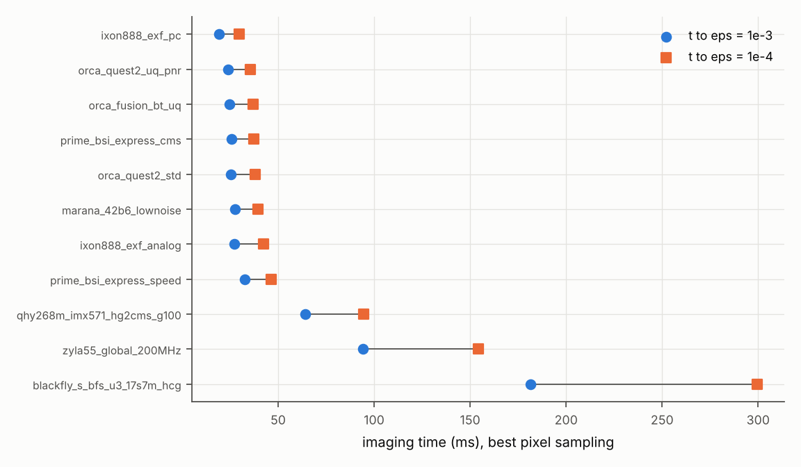
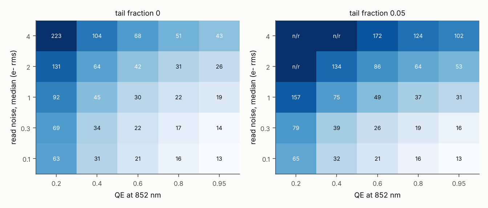

# P1 production check-in: camera presets and reduced generic sweep

CAQSAT lab, IIT Madras. Check-in 2 of 2 required by rule 7 (after the first production sweep,
before scaling up). Generated by `python -m p1_atomdet.production_report` from
`runs/production/*/*.h5`; every number in the tables is read from those files.

## Summary

1. **Ranking of the 11 presets** (Table P-1, Fig. P-1). In the reference Cs scenario
   (V1-anchored photon budget and loss, NA 0.55, best pixel sampling, matched filter), the time to
   reach infidelity 1e-4 is 30 ms for the iXon Ultra 888 EXF in multi-frame photon counting,
   36 to 40 ms for five low-noise CMOS configurations (ORCA-Quest 2 PNR, ORCA-Fusion BT, Prime BSI
   Express CMS, ORCA-Quest 2 standard, Marana), 46 ms for the Prime BSI Express in Speed mode, and
   94 to 300 ms for the QHY268M (IMX571), Zyla 5.5 and Blackfly S.
2. **What sets the imaging time** (Tables P-3, P-4). QE dominates (t roughly proportional to 1/QE).
   Read noise matters little below 0.3 e- median and strongly above 1 e-; a 5% fraction of pixels
   at five times the median read noise costs a factor 1.8 at 1 e-. Background from 0 to 3 times the V1
   level changes t by 1.4x; pixel sampling by 1.3x over 0.35 to 1.5 px per FWHM.
3. **Pixel sampling rule** (Table P-5). The optimal sampling falls with read noise: 1.5 px per FWHM
   or more at 0.1 e- (upper edge of the grid), 1.0 at 0.3 e-, 0.5 at 1 to 2 e-, 0.35 or less at 4 e-
   (lower edge). The optimum is shallow (within 10% over a factor of two in sampling).
4. **Prime BSI Express, preliminary operating point** (Sec. 6). CMS mode, magnification 4.0
   (0.5 px per FWHM), matched filter: t(1e-3) = 25.7 ms, t(1e-4) = 37.5 ms, eps = 6.64e-5 at 40 ms
   in the reference scenario. Speed mode costs about 23% in time (46.3 ms).
5. **Cost.** This stage used 0.6 + 7.3 + 0.2 CPU-h on the 4-core instance
   (median 17 CPU-s per generic point). The full generic sweep proposed in Sec. 7
   (46656 points) needs about 216 CPU-h and a Sobol analysis about 47 CPU-h; both fit the
   IIT Madras HPC easily, and the Sobol analysis would also run on this instance in about half a day.

6. **Atom loss can make 1e-4 unreachable whatever the camera** (Sec. 5). With the loss per photon
   bounded from Picken et al. (5.6e-7, 24 times the V1 value), loss during the exposure sets a
   floor near eps ~ 3e-4 at 40 ms and no camera reaches 1e-4. The 1e-4 specification therefore
   presumes V1-level cooling and vacuum.
7. **The read-noise tail is the most consequential unknown camera input** (Sec. 5). For the Prime
   BSI Express, 2% of pixels at 5x the median read noise raises t(1e-4) from 37.5 to 56.6 ms (+51%),
   whereas the QE uncertainty (+-1.5% absolute) moves it by 3%, and the EMCCD CIC split by under 10%.

These are model results for one reference scenario. The scenario inherits the V1 fit, so the
caveats of the validation report apply: in particular the V1 false-positive excess is an
experimental floor that none of these cameras removes.

## 1. What was run

(i) Eleven `SensorModel` presets (Sec. 3) built from the four PDFs supplied by the PI and from
vendor documents retrieved and checked on 2026-10-15 (`sources/README.md`), each at seven pixel
samplings; (ii) a reduced generic CMOS-class sweep of 750 points over QE, read-noise median,
read-noise tail fraction, pixel sampling and background; (iii) a sensitivity study of the
preset results to their uncertain inputs. All runs are resumable with per-point checkpoints and
CPU accounting (`runs/production/run_all.sh`).

Method changes since the validation report: a characteristic-function (CF) engine for linear
statistics (box sum, matched filter), about 10^3 times faster than the lattice engine and equal to
it within 2% in optimal infidelity (`tests/test_cf_production.py`); multi-frame EMCCD photon counting
with a quadrature click probability (more accurate than the lattice at h = 0.004, and consistent
with a stage-by-stage register Monte Carlo); per-site thresholds averaged over the sub-pixel
position of the site (9 offsets). The CF engine omits ADC rounding: for the ORCA-Quest 2 in PNR mode
the exact rounding lowers eps by 7% at the operating point (about 1 to 2% in imaging time), so the
PNR results are slightly conservative; for the Prime BSI Express (0.25 e-/ADU placeholder) the
difference is 0.4%.

## 2. Reference scenario and assumptions

`configs/production/reference_cs.yaml`: Cs D2, scattering rate 72.3 kc/s, NA 0.55 with optical
transmission 0.327 after collection (2.7% of scattered photons to the camera, as in V1), loss
2.35e-8 per scattered photon (V1 survival, includes vacuum loss), site-to-site rate spread 12.3%
(V1 Fig. 4d), background 4.76 e-/px/s at the V1 pixel (0.902 um object plane, QE 0.44) scaled
with object-plane pixel area and QE, filling 0.5. Assumptions: (i) diffraction-limited vectorial
PSF at NA 0.55 (FWHM 0.82 um; the measured V1 PSF has FWHM 1.70 um, 2.1 times wider, so absolute
times here are optimistic and the best sampling in px per FWHM shifts up); (ii) uniform background; (iii) no neighbour
crosstalk (spacing large compared with the PSF); (iv) read-noise tails, where a vendor gives median
and rms, are a two-class model with tail pixels at 3x the median (presets) or 5x (generic sweep);
P4 will replace these with measured distributions; (v) dark current at the vendor's stated
operating temperature; (vi) survival is not limiting (loss 1.7e-3 per second of imaging).

## 3. Camera presets

**Table P-1. Presets at their best pixel sampling** (matched filter; photon counting uses an
SNR-optimal box). QE at 852 nm is digitised from vendor typical curves (DATA, +-1.5 to 2%).

| camera | mode | QE 852 | read median/rms (e-) | best px/FWHM | magnification | classifier | t(1e-3) ms | t(1e-4) ms | eps(40 ms) | FP / FN (40 ms) |
|---|---|---|---|---|---|---|---|---|---|---|
| iXon Ultra 888 EXF (CCD201) | EM amplifier 10 MHz | 0.608 | EM x1000 | 1.4 | 22.3 | PC box | 19.3 | 29.6 | 2.11e-5 | 9.49e-6 / 3.27e-5 |
| ORCA-Quest 2 C15550-22UP | ultra quiet scan | 0.384 | 0.25/0.30 | 1 | 5.6 | matched | 23.8 | 35.7 | 5.02e-5 | 2.77e-5 / 7.28e-5 |
| ORCA-Fusion BT C15440-20UP | ultra quiet scan | 0.464 | 0.60/0.70 | 0.5 | 4.0 | matched | 24.7 | 36.9 | 6.13e-5 | 3.92e-5 / 8.34e-5 |
| Prime BSI Express (GSENSE2020BSI) | CMS (100 MHz) | 0.485 | 1.00/1.00 | 0.5 | 4.0 | matched | 25.7 | 37.5 | 6.64e-5 | 3.88e-5 / 9.39e-5 |
| ORCA-Quest 2 C15550-22UP | standard scan | 0.384 | 0.39/0.43 | 0.7 | 3.9 | matched | 25.3 | 37.9 | 7.25e-5 | 4.35e-5 / 1.02e-4 |
| Marana 4.2B-6 | low noise 12-bit | 0.470 | 1.10/1.10 | 0.5 | 4.0 | matched | 27.4 | 39.6 | 9.40e-5 | 5.59e-5 / 1.32e-4 |
| iXon Ultra 888 EXF (CCD201) | EM amplifier 10 MHz | 0.608 | EM x1000 | 3 | 47.8 | matched | 27.0 | 42.5 | 1.39e-4 | 1.15e-4 / 1.63e-4 |
| Prime BSI Express (GSENSE2020BSI) | Speed (200 MHz) | 0.485 | 1.60/1.60 | 0.5 | 4.0 | matched | 32.5 | 46.3 | 2.68e-4 | 1.73e-4 / 3.62e-4 |
| QHYCCD QHY268M (Sony IMX571 mono) | High Gain-2CMS | 0.208 | 1.19/1.19 | 0.5 | 2.3 | matched | 64.3 | 94.4 | 0.00976 | 0.00656 / 0.013 |
| Zyla 5.5 sCMOS | global shutter | 0.249 | 2.30/2.50 | 0.35 | 2.8 | matched | 94.2 | 154.2 | 0.0257 | 0.0213 / 0.03 |
| Teledyne FLIR Blackfly S BFS-U3-17S7M (Sony IMX425) | high conversion gain | 0.186 | 4.69/4.69 | 0.35 | 3.9 | matched | 181.5 | 299.6 | 0.159 | 0.139 / 0.179 |

**Table P-2. Time to eps = 1e-4 (ms) versus pixel sampling** (px per PSF FWHM; n/r: not reached
within 300 ms with survival >= 0.99).

| preset \ px per FWHM | 0.35 | 0.5 | 0.7 | 1 | 1.4 | 2 | 3 |
|---|---|---|---|---|---|---|---|
| orca_quest2_std | 43.5 | 39.3 | 37.9 | 38.5 | 40.6 | 44.9 | 53.3 |
| orca_quest2_uq_pnr | 42.5 | 38.0 | 36.0 | 35.7 | 36.6 | 39.0 | 44.4 |
| prime_bsi_express_cms | 39.6 | 37.5 | 38.1 | 41.0 | 46.8 | 56.7 | 75.0 |
| prime_bsi_express_speed | 47.3 | 46.3 | 48.5 | 53.5 | 62.9 | 78.9 | 108.0 |
| zyla55_global_200MHz | 154.2 | 161.2 | 173.9 | 195.0 | 229.8 | n/r | n/r |
| ixon888_exf_analog | 55.4 | 49.1 | 45.9 | 44.1 | 43.1 | 42.6 | 42.5 |
| ixon888_exf_pc | 36.7 | 33.3 | 30.0 | 30.0 | 29.6 | 31.3 | 35.5 |
| orca_fusion_bt_uq | 39.0 | 36.9 | 37.3 | 39.5 | 43.5 | 50.2 | 62.6 |
| marana_42b6_lownoise | 41.7 | 39.6 | 40.5 | 43.7 | 49.9 | 60.6 | 79.9 |
| qhy268m_imx571_hg2cms_g100 | 99.2 | 94.4 | 96.8 | 105.1 | 121.4 | 149.6 | 202.9 |
| blackfly_s_bfs_u3_17s7m_hcg | 299.6 | n/r | n/r | n/r | n/r | n/r | n/r |

*Figure P-1. Imaging time to infidelity 1e-3 (circles) and 1e-4 (squares) for each preset at its best
pixel sampling, reference Cs scenario (Sec. 2), CF engine with per-site matched filter (EMCCD photon
counting: Poisson-binomial counts over an SNR-optimal box, frames at 670 fps for a 128x128 crop).
Error rates averaged over 9 sub-pixel site positions; threshold optimised per site.*

Remarks. (i) The ORCA-Quest 2 enters with QE 0.384 at 852 nm from the Hamamatsu typical curve; the
same vendor's curve for the original ORCA-Quest gives 0.396, while Manetsch et al. state 0.44 for
their camera. With 0.44 the Quest 2 times would fall by about 13% (t roughly proportional to 1/QE). (ii) The iXon advantage requires
photon counting over many short frames (26 frames in 40 ms at 670 fps for a 128x128 crop); in analog
mode the excess noise factor (F^2 = 1.97) cancels the QE advantage. (iii) The QHY268M uses High Gain
2CMS at gain 100 (read noise 1.19 e-, digitised) as the PI requested; its limit is QE (0.21).
(iv) The Blackfly S never reaches 1e-4 within 300 ms (4.7 e- read noise, QE 0.19).

## 4. Generic CMOS-class sweep (reduced)

Axes: QE 0.2 to 0.95; read-noise median 0.1 to 4 e-; tail fraction 0 or 5% (tail pixels at 5x the
median); 0.35 to 1.5 px per FWHM; background 0, 1 and 3 times the reference. No dark current, no ADC.

*Figure P-2. Time to eps = 1e-4 (ms, numbers in cells; colour log scale) in the plane of QE at 852 nm
and read-noise median, each cell at its best pixel sampling (0.35 to 1.5 px per FWHM), reference
background, matched filter, reference Cs scenario. Left: Gaussian read noise. Right: 5% of pixels at
5x the median. n/r: not reached within 300 ms.*

**Table P-3. One-at-a-time ranges of t(1e-4)** about QE 0.6, read noise 1.0 e-, no tail, 0.7 px per
FWHM, reference background (a ranking proxy until the Sobol analysis).

| parameter | values | t(1e-4) (ms), others at reference | max/min |
|---|---|---|---|
| qe | 0.2, 0.4, 0.6, 0.8, 0.95 | 92.7, 45.5, 30.2, 22.6, 19.0 | 4.88 |
| read_median_e | 0.1, 0.3, 1, 2, 4 | 22.0, 22.8, 30.2, 44.6, 75.9 | 3.45 |
| tail_fraction | 0, 0.05 | 30.2, 53.2 | 1.76 |
| bg_scale | 0, 1, 3 | 26.7, 30.2, 36.1 | 1.36 |
| px_per_fwhm | 0.35, 0.5, 0.7, 1, 1.5 | 31.6, 29.8, 30.2, 32.4, 37.9 | 1.27 |

**Table P-4. The same for t(1e-3).**

| parameter | values | t(1e-4) (ms), others at reference | max/min |
|---|---|---|---|
| qe | 0.2, 0.4, 0.6, 0.8, 0.95 | 63.9, 31.9, 21.3, 15.9, 13.4 | 4.76 |
| read_median_e | 0.1, 0.3, 1, 2, 4 | 14.3, 15.1, 21.3, 32.3, 55.2 | 3.86 |
| tail_fraction | 0, 0.05 | 21.3, 35.7 | 1.68 |
| px_per_fwhm | 0.35, 0.5, 0.7, 1, 1.5 | 21.1, 20.5, 21.3, 23.2, 27.5 | 1.34 |
| bg_scale | 0, 1, 3 | 19.4, 21.3, 24.5 | 1.26 |

**Table P-5. Best pixel sampling (and the resulting t(1e-4)) per QE and read-noise median**, no tail,
reference background.

| read median (e-) \ QE | 0.2 | 0.4 | 0.6 | 0.8 | 0.95 |
|---|---|---|---|---|---|
| 0.1 | 1.5 (63 ms) | 1.5 (31 ms) | 1.5 (21 ms) | 1.5 (16 ms) | 1.5 (13 ms) |
| 0.3 | 1 (69 ms) | 1 (34 ms) | 1 (22 ms) | 1 (17 ms) | 1 (14 ms) |
| 1 | 0.5 (92 ms) | 0.5 (45 ms) | 0.5 (30 ms) | 0.5 (22 ms) | 0.5 (19 ms) |
| 2 | 0.5 (131 ms) | 0.5 (64 ms) | 0.5 (42 ms) | 0.5 (31 ms) | 0.5 (26 ms) |
| 4 | 0.35 (223 ms) | 0.35 (104 ms) | 0.35 (68 ms) | 0.35 (51 ms) | 0.35 (43 ms) |

The optima at 0.1 e- and 4 e- lie on the edges of the sampled range and are not bracketed; the full sweep extends the sampling axis to 0.25 and 2.5 px per FWHM. The matched filter is faster than the SNR-optimal box sum by 7% (median over the grid) to 18%.

At 80 ms every Prime BSI sampling in Table P-6 reaches eps ~ 1.5e-5: this is the loss floor of the reference scenario (atoms lost early in the exposure), not a camera limit.

## 5. Sensitivity of the preset results to uncertain inputs

| case | preset | change | px/FWHM | classifier | t(1e-3) ms | t(1e-4) ms | eps(40 ms) |
|---|---|---|---|---|---|---|---|
| base_bsi | prime_bsi_express_cms | baseline | 0.5 | matched | 25.7 | 37.5 | 6.64e-5 |
| base_bsi | prime_bsi_express_cms | baseline | 1 | matched | 29.1 | 41.0 | 1.20e-4 |
| bsi_tail2pct | prime_bsi_express_cms | read_tail_fraction=0.02 | 0.5 | matched | 35.8 | 56.6 | 6.12e-4 |
| bsi_tail2pct | prime_bsi_express_cms | read_tail_fraction=0.02 | 1 | matched | 42.0 | 64.3 | 0.00124 |
| bsi_qe_lo | prime_bsi_express_cms | qe_override=0.47 | 0.5 | matched | 26.5 | 38.7 | 8.13e-5 |
| bsi_qe_lo | prime_bsi_express_cms | qe_override=0.47 | 1 | matched | 30.1 | 42.4 | 1.50e-4 |
| bsi_qe_hi | prime_bsi_express_cms | qe_override=0.5 | 0.5 | matched | 24.9 | 36.3 | 5.47e-5 |
| bsi_qe_hi | prime_bsi_express_cms | qe_override=0.5 | 1 | matched | 28.3 | 39.8 | 9.60e-5 |
| bsi_loss_high | prime_bsi_express_cms | loss=high | 0.5 | matched | 26.5 | n/r | 2.84e-4 |
| bsi_loss_high | prime_bsi_express_cms | loss=high | 1 | matched | 30.1 | n/r | 3.48e-4 |
| base_q2pnr | orca_quest2_uq_pnr | baseline | 0.5 | matched | 24.7 | 38.0 | 7.50e-5 |
| base_q2pnr | orca_quest2_uq_pnr | baseline | 1 | matched | 23.8 | 35.7 | 5.02e-5 |
| q2pnr_loss_high | orca_quest2_uq_pnr | loss=high | 0.5 | matched | 25.5 | n/r | 2.85e-4 |
| q2pnr_loss_high | orca_quest2_uq_pnr | loss=high | 1 | matched | 24.5 | n/r | 2.47e-4 |
| ixon_pc_freg0 | ixon888_exf_pc | cic_register_fraction=0.0 | 0.5 | box | 21.6 | 33.5 | 3.89e-5 |
| ixon_pc_freg0 | ixon888_exf_pc | cic_register_fraction=0.0 | 1 | box | 20.1 | 30.8 | 2.45e-5 |
| ixon_pc_freg1 | ixon888_exf_pc | cic_register_fraction=1.0 | 0.5 | box | 20.9 | 33.2 | 3.43e-5 |
| ixon_pc_freg1 | ixon888_exf_pc | cic_register_fraction=1.0 | 1 | box | 18.5 | 28.5 | 1.72e-5 |
| ixon_an_freg0 | ixon888_exf_analog | cic_register_fraction=0.0 | 0.5 | matched | 30.7 | 49.1 | 2.86e-4 |
| ixon_an_freg0 | ixon888_exf_analog | cic_register_fraction=0.0 | 1 | matched | 27.9 | 44.2 | 1.69e-4 |
| ixon_an_freg1 | ixon888_exf_analog | cic_register_fraction=1.0 | 0.5 | matched | 30.7 | 49.0 | 2.84e-4 |
| ixon_an_freg1 | ixon888_exf_analog | cic_register_fraction=1.0 | 1 | matched | 27.7 | 44.0 | 1.65e-4 |
| base_bfs | blackfly_s_bfs_u3_17s7m_hcg | baseline | 0.5 | matched | 190.7 | n/r | 0.179 |
| base_bfs | blackfly_s_bfs_u3_17s7m_hcg | baseline | 1 | matched | 239.6 | n/r | 0.243 |
| bfs_loss_high | blackfly_s_bfs_u3_17s7m_hcg | loss=high | 0.5 | matched | n/r | n/r | 0.179 |
| bfs_loss_high | blackfly_s_bfs_u3_17s7m_hcg | loss=high | 1 | matched | n/r | n/r | 0.243 |

## 6. Prime BSI Express: preliminary operating point

**Table P-6. Prime BSI Express, CMS mode, in the reference scenario** (matched filter unless stated).

| px/FWHM | magnification | object-plane pixel (um) | eps(20 ms) | eps(40 ms) | eps(80 ms) | t(1e-3) ms | t(1e-4) ms | t(1e-4) ms, box |
|---|---|---|---|---|---|---|---|---|
| 0.35 | 2.8 | 2.33 | 0.00369 | 9.47e-5 | 1.63e-5 | 26.4 | 39.6 | 39.8 |
| 0.5 | 4.0 | 1.63 | 0.00356 | 6.64e-5 | 1.49e-5 | 25.7 | 37.5 | 41.5 |
| 0.7 | 5.6 | 1.17 | 0.0045 | 7.27e-5 | 1.46e-5 | 26.7 | 38.1 | 40.2 |
| 1 | 8.0 | 0.82 | 0.00723 | 1.20e-4 | 1.53e-5 | 29.1 | 41.0 | 44.8 |
| 1.4 | 11.1 | 0.58 | 0.0139 | 3.09e-4 | 1.72e-5 | 33.6 | 46.8 | 50.8 |
| 2 | 15.9 | 0.41 | 0.0306 | 0.00117 | 2.24e-5 | 41.0 | 56.7 | 61.9 |
| 3 | 23.9 | 0.27 | 0.0709 | 0.00601 | 6.67e-5 | 54.2 | 75.0 | 81.9 |

Preliminary recipe, to be refined after the full sweep: CMS mode (1.0 e-), magnification about
4.0 so that one 6.5 um pixel spans about two PSF FWHM in the object plane, matched filter with per-site
weights and threshold, imaging time 37.5 ms for 1e-4 in this scenario. A 2048 x 128 ROI reads out in
1.46 ms (128 rows at 11.4 us); with continuous imaging light the exposure must exceed the
imaging time by that amount so that every row sees the full pulse. Dark current at 0 C (1.5 e-/px/s)
adds 0.06 e- per pixel in 40 ms, small compared with the background at this sampling. The read-noise tail
of the GSENSE2020BSI is not specified (only "1.0 e-"); a 2% tail at 5x the median changes the times
as shown in Sec. 5, and a measured read-noise map (P4 or a dark-frame measurement on our camera)
is the most useful next input. The Bayesian per-pixel classifier, which can exploit a measured
noise map, is not yet included here.

## 7. Computational cost and proposed full stage

| study | points | CPU-h total | median CPU-s/point | max CPU-s/point | peak RSS (MB) |
|---|---|---|---|---|---|
| presets | 77 | 0.63 | 19 | 142 | 347 |
| generic (reduced) | 750 | 7.33 | 17 | 268 | 711 |
| sensitivity | 26 | 0.17 | 17 | 49 | 261 |

Proposed next steps (on approval): (i) full generic sweep on the IIT Madras HPC: QE (6) x read-noise
median (6) x tail (3) x sampling (6) x background (4) x NA (3) x dark current (3) x loss per photon (3),
46656 points, about 216 CPU-h with the SLURM templates; an EMCCD branch (EM gain, CIC,
photon-counting frame rate) of similar size; (ii) Sobol indices (SALib, N = 1024, 8 parameters,
about 47 CPU-h) for t(1e-3) and t(1e-4); (iii) spec-to-fidelity contour maps, the Stage 1
camera specification and the Prime BSI Express recipe including the Bayesian classifier with a
measured noise map.

## 8. Decisions needed

1. Approve the full sweep and the Sobol analysis (HPC account and partition details are needed for
   the SLURM templates, marked [CONFIRM?]); or run the Sobol analysis on this instance first.
2. Confirm the reference scenario (Sec. 2), in particular whether to use the measured V1 PSF width
   instead of the diffraction limit, and whether 0.5 is the right filling for the specification.
3. A dark-frame stack from our Prime BSI Express, when it arrives, would replace the assumed
   read-noise tail.

## Open placeholders (116)

- `camsim_common/presets/blackfly_s_bfs_u3_17s7m_hcg.yaml`: `prnu` = [VALUE?: approx. 0.005, verify] (not stated)
- `camsim_common/presets/blackfly_s_bfs_u3_17s7m_hcg.yaml`: `read_noise_median_e` = [VALUE?: approx. 4.69 e-, verify] (EMVA temporal dark noise (mean); median not given)
- `camsim_common/presets/blackfly_s_bfs_u3_17s7m_hcg.yaml`: `adc.offset_adu` = [VALUE?: approx. 0 ADU, verify]
- `camsim_common/presets/blackfly_s_bfs_u3_17s7m_hcg.yaml`: `dark.D_ref` = [VALUE?: approx. 5.0 e-/px/s, verify] (uncooled; not stated)
- `camsim_common/presets/blackfly_s_bfs_u3_17s7m_hcg.yaml`: `dark.T_ref_K` = [VALUE?: approx. 313.0 K, verify] (uncooled)
- `camsim_common/presets/blackfly_s_bfs_u3_17s7m_hcg.yaml`: `dark.Ea_eV` = [VALUE?: approx. 0.6 eV, verify]
- `camsim_common/presets/blackfly_s_bfs_u3_17s7m_hcg.yaml`: `dark.T_op_K` = [VALUE?: approx. 313.0 K, verify] (uncooled board temperature)
- `camsim_common/presets/blackfly_s_bfs_u3_17s7m_hcg.yaml`: `shutter.line_time_us` = [VALUE?: approx. 0.0 us, verify] (global shutter)
- `camsim_common/presets/blackfly_s_bfs_u3_17s7m_hcg.yaml`: `cosmic.rate_per_cm2_s` = [VALUE?: approx. 0.0167 cm^-2 s^-1, verify] (sea-level muon flux ~1 cm^-2 min^-1, recalled)
- `camsim_common/presets/blackfly_s_bfs_u3_17s7m_hcg.yaml`: `cosmic.deposit_e_per_um` = [VALUE?: approx. 80 e-/um, verify] (MIP deposit in Si, recalled)
- `camsim_common/presets/blackfly_s_bfs_u3_17s7m_hcg.yaml`: `cosmic.thickness_um` = [VALUE?: approx. 5.0 um, verify] (sensitive thickness not stated)
- `camsim_common/presets/ixon888_exf_analog.yaml`: `prnu` = [VALUE?: approx. 0.005, verify] (not stated)
- `camsim_common/presets/ixon888_exf_analog.yaml`: `adc.gain_e_per_adu` = [VALUE?: approx. 10.0 e-/ADU (output), verify] (not stated)
- `camsim_common/presets/ixon888_exf_analog.yaml`: `adc.offset_adu` = [VALUE?: approx. 100 ADU, verify]
- `camsim_common/presets/ixon888_exf_analog.yaml`: `dark.Ea_eV` = [VALUE?: approx. 0.6 eV, verify] (single vendor point; P4 to supply D(T))
- `camsim_common/presets/ixon888_exf_analog.yaml`: `emccd.n_stages` = [VALUE?: approx. 604, verify] (CCD201 register length not stated; recalled)
- `camsim_common/presets/ixon888_exf_analog.yaml`: `emccd.cic_register_fraction` = [VALUE?: approx. 0.5, verify] (split of CIC between parallel and register; swept 0-1)
- `camsim_common/presets/ixon888_exf_analog.yaml`: `shutter.line_time_us` = [VALUE?: approx. 0.0 us, verify] (frame transfer)
- `camsim_common/presets/ixon888_exf_analog.yaml`: `cosmic.rate_per_cm2_s` = [VALUE?: approx. 0.0167 cm^-2 s^-1, verify] (sea-level muon flux ~1 cm^-2 min^-1, recalled)
- `camsim_common/presets/ixon888_exf_analog.yaml`: `cosmic.deposit_e_per_um` = [VALUE?: approx. 80 e-/um, verify] (MIP deposit in Si, recalled)
- `camsim_common/presets/ixon888_exf_analog.yaml`: `cosmic.thickness_um` = [VALUE?: approx. 10.0 um, verify] (sensitive thickness not stated)
- `camsim_common/presets/ixon888_exf_pc.yaml`: `prnu` = [VALUE?: approx. 0.005, verify] (not stated)
- `camsim_common/presets/ixon888_exf_pc.yaml`: `adc.gain_e_per_adu` = [VALUE?: approx. 10.0 e-/ADU (output), verify] (not stated)
- `camsim_common/presets/ixon888_exf_pc.yaml`: `adc.offset_adu` = [VALUE?: approx. 100 ADU, verify]
- `camsim_common/presets/ixon888_exf_pc.yaml`: `dark.Ea_eV` = [VALUE?: approx. 0.6 eV, verify] (single vendor point; P4 to supply D(T))
- `camsim_common/presets/ixon888_exf_pc.yaml`: `emccd.n_stages` = [VALUE?: approx. 604, verify] (CCD201 register length not stated; recalled)
- `camsim_common/presets/ixon888_exf_pc.yaml`: `emccd.cic_register_fraction` = [VALUE?: approx. 0.5, verify] (split of CIC between parallel and register; swept 0-1)
- `camsim_common/presets/ixon888_exf_pc.yaml`: `shutter.line_time_us` = [VALUE?: approx. 0.0 us, verify] (frame transfer)
- `camsim_common/presets/ixon888_exf_pc.yaml`: `cosmic.rate_per_cm2_s` = [VALUE?: approx. 0.0167 cm^-2 s^-1, verify] (sea-level muon flux ~1 cm^-2 min^-1, recalled)
- `camsim_common/presets/ixon888_exf_pc.yaml`: `cosmic.deposit_e_per_um` = [VALUE?: approx. 80 e-/um, verify] (MIP deposit in Si, recalled)
- `camsim_common/presets/ixon888_exf_pc.yaml`: `cosmic.thickness_um` = [VALUE?: approx. 10.0 um, verify] (sensitive thickness not stated)
- `camsim_common/presets/marana_42b6_lownoise.yaml`: `prnu` = [VALUE?: approx. 0.005, verify] (not stated)
- `camsim_common/presets/marana_42b6_lownoise.yaml`: `read_noise_rms_e` = [VALUE?: approx. 1.1 e-, verify] (rms not stated)
- `camsim_common/presets/marana_42b6_lownoise.yaml`: `adc.gain_e_per_adu` = [VALUE?: approx. 0.3 e-/ADU, verify] (not stated)
- `camsim_common/presets/marana_42b6_lownoise.yaml`: `adc.offset_adu` = [VALUE?: approx. 100 ADU, verify]
- `camsim_common/presets/marana_42b6_lownoise.yaml`: `cosmic.rate_per_cm2_s` = [VALUE?: approx. 0.0167 cm^-2 s^-1, verify] (sea-level muon flux ~1 cm^-2 min^-1, recalled)
- `camsim_common/presets/marana_42b6_lownoise.yaml`: `cosmic.deposit_e_per_um` = [VALUE?: approx. 80 e-/um, verify] (MIP deposit in Si, recalled)
- `camsim_common/presets/marana_42b6_lownoise.yaml`: `cosmic.thickness_um` = [VALUE?: approx. 10.0 um, verify] (sensitive thickness not stated)
- `camsim_common/presets/orca_fusion_bt_uq.yaml`: `cosmic.rate_per_cm2_s` = [VALUE?: approx. 0.0167 cm^-2 s^-1, verify] (sea-level muon flux ~1 cm^-2 min^-1, recalled)
- `camsim_common/presets/orca_fusion_bt_uq.yaml`: `cosmic.deposit_e_per_um` = [VALUE?: approx. 80 e-/um, verify] (MIP deposit in Si, recalled)
- `camsim_common/presets/orca_fusion_bt_uq.yaml`: `cosmic.thickness_um` = [VALUE?: approx. 10.0 um, verify] (sensitive thickness not stated)
- `camsim_common/presets/orca_quest2_std.yaml`: `cosmic.rate_per_cm2_s` = [VALUE?: approx. 0.0167 cm^-2 s^-1, verify] (sea-level muon flux ~1 cm^-2 min^-1, recalled)
- `camsim_common/presets/orca_quest2_std.yaml`: `cosmic.deposit_e_per_um` = [VALUE?: approx. 80 e-/um, verify] (MIP deposit in Si, recalled)
- `camsim_common/presets/orca_quest2_std.yaml`: `cosmic.thickness_um` = [VALUE?: approx. 10.0 um, verify] (sensitive thickness not stated)
- `camsim_common/presets/orca_quest2_uq_pnr.yaml`: `cosmic.rate_per_cm2_s` = [VALUE?: approx. 0.0167 cm^-2 s^-1, verify] (sea-level muon flux ~1 cm^-2 min^-1, recalled)
- `camsim_common/presets/orca_quest2_uq_pnr.yaml`: `cosmic.deposit_e_per_um` = [VALUE?: approx. 80 e-/um, verify] (MIP deposit in Si, recalled)
- `camsim_common/presets/orca_quest2_uq_pnr.yaml`: `cosmic.thickness_um` = [VALUE?: approx. 10.0 um, verify] (sensitive thickness not stated)
- `camsim_common/presets/orca_quest_c15550_20up_manetsch.yaml`: `qe_780` = [VALUE?: approx. None, verify] (not used in V1)
- `camsim_common/presets/orca_quest_c15550_20up_manetsch.yaml`: `prnu` = [VALUE?: approx. 0.0, verify] (not stated; effect on V1 tested in the sensitivity table)
- `camsim_common/presets/orca_quest_c15550_20up_manetsch.yaml`: `read_noise.sigma_e` = [VALUE?: approx. 0.43 e- rms, verify] (ORCA-Quest 2 standard-scan value from USER table; C15550-20UP value not retrieved)
- `camsim_common/presets/orca_quest_c15550_20up_manetsch.yaml`: `read_noise_median_e` = [VALUE?: approx. 0.43 e-, verify] (as sigma)
- `camsim_common/presets/orca_quest_c15550_20up_manetsch.yaml`: `read_noise_rms_e` = [VALUE?: approx. 0.43 e-, verify] (as sigma)
- `camsim_common/presets/orca_quest_c15550_20up_manetsch.yaml`: `adc.gain_e_per_adu` = [VALUE?: approx. 0.107 e-/ADU, verify] (recalled; V1 works in photoelectrons, quantisation step < 0.25 sigma)
- `camsim_common/presets/orca_quest_c15550_20up_manetsch.yaml`: `adc.adc_bits` = [VALUE?: approx. 16 bit, verify] (recalled)
- `camsim_common/presets/orca_quest_c15550_20up_manetsch.yaml`: `adc.full_well_e` = [VALUE?: approx. 7000 e-, verify] (recalled; V1 pixel signals < 20 e-)
- `camsim_common/presets/orca_quest_c15550_20up_manetsch.yaml`: `adc.offset_adu` = [VALUE?: approx. 200 ADU, verify] (recalled)
- `camsim_common/presets/orca_quest_c15550_20up_manetsch.yaml`: `dark.D_ref` = [VALUE?: approx. 0.016 e-/px/s, verify] (recalled; dark over 49 px x 80 ms < 0.07 e-)
- `camsim_common/presets/orca_quest_c15550_20up_manetsch.yaml`: `dark.T_ref_K` = [VALUE?: approx. 238.15 K, verify] (recalled cooling set point)
- `camsim_common/presets/orca_quest_c15550_20up_manetsch.yaml`: `dark.Ea_eV` = [VALUE?: approx. 0.6 eV, verify] (generic Si; P4 to supply)
- `camsim_common/presets/orca_quest_c15550_20up_manetsch.yaml`: `dark.T_op_K` = [VALUE?: approx. 238.15 K, verify] (recalled)
- `camsim_common/presets/orca_quest_c15550_20up_manetsch.yaml`: `shutter.line_time_us` = [VALUE?: approx. 7.2 us, verify] (recalled; irrelevant for 80 ms continuous imaging)
- `camsim_common/presets/orca_quest_c15550_20up_manetsch.yaml`: `shutter.frame_time_ms` = [VALUE?: approx. 80.0 ms, verify] (set by the experiment)
- `camsim_common/presets/orca_quest_c15550_20up_manetsch.yaml`: `cosmic.rate_per_cm2_s` = [VALUE?: approx. 0.0167 cm^-2 s^-1, verify] (sea-level muon flux ~1 cm^-2 min^-1, recalled; retrieve PDG value)
- `camsim_common/presets/orca_quest_c15550_20up_manetsch.yaml`: `cosmic.deposit_e_per_um` = [VALUE?: approx. 80 e-/um, verify] (minimum-ionising deposit in Si, recalled)
- `camsim_common/presets/orca_quest_c15550_20up_manetsch.yaml`: `cosmic.thickness_um` = [VALUE?: approx. 10.0 um, verify] (sensitive thickness not stated in a retrieved source)
- `camsim_common/presets/prime_bsi_express_cms.yaml`: `prnu` = [VALUE?: approx. 0.005, verify] (not stated in the datasheet)
- `camsim_common/presets/prime_bsi_express_cms.yaml`: `read_noise_rms_e` = [VALUE?: approx. 1.0 e-, verify] (rms not stated; tail unknown; swept)
- `camsim_common/presets/prime_bsi_express_cms.yaml`: `adc.gain_e_per_adu` = [VALUE?: approx. 0.25 e-/ADU, verify] (not stated; ~full well / 2^bits)
- `camsim_common/presets/prime_bsi_express_cms.yaml`: `adc.offset_adu` = [VALUE?: approx. 100 ADU, verify] (not stated)
- `camsim_common/presets/prime_bsi_express_cms.yaml`: `cosmic.rate_per_cm2_s` = [VALUE?: approx. 0.0167 cm^-2 s^-1, verify] (sea-level muon flux ~1 cm^-2 min^-1, recalled)
- `camsim_common/presets/prime_bsi_express_cms.yaml`: `cosmic.deposit_e_per_um` = [VALUE?: approx. 80 e-/um, verify] (MIP deposit in Si, recalled)
- `camsim_common/presets/prime_bsi_express_cms.yaml`: `cosmic.thickness_um` = [VALUE?: approx. 10.0 um, verify] (sensitive thickness not stated)
- `camsim_common/presets/prime_bsi_express_speed.yaml`: `prnu` = [VALUE?: approx. 0.005, verify] (not stated in the datasheet)
- `camsim_common/presets/prime_bsi_express_speed.yaml`: `read_noise_rms_e` = [VALUE?: approx. 1.6 e-, verify] (rms not stated; tail unknown; swept)
- `camsim_common/presets/prime_bsi_express_speed.yaml`: `adc.gain_e_per_adu` = [VALUE?: approx. 5.0 e-/ADU, verify] (not stated; ~full well / 2^bits)
- `camsim_common/presets/prime_bsi_express_speed.yaml`: `adc.offset_adu` = [VALUE?: approx. 100 ADU, verify] (not stated)
- `camsim_common/presets/prime_bsi_express_speed.yaml`: `cosmic.rate_per_cm2_s` = [VALUE?: approx. 0.0167 cm^-2 s^-1, verify] (sea-level muon flux ~1 cm^-2 min^-1, recalled)
- `camsim_common/presets/prime_bsi_express_speed.yaml`: `cosmic.deposit_e_per_um` = [VALUE?: approx. 80 e-/um, verify] (MIP deposit in Si, recalled)
- `camsim_common/presets/prime_bsi_express_speed.yaml`: `cosmic.thickness_um` = [VALUE?: approx. 10.0 um, verify] (sensitive thickness not stated)
- `camsim_common/presets/qhy268m_imx571_hg2cms_g100.yaml`: `prnu` = [VALUE?: approx. 0.005, verify] (not stated)
- `camsim_common/presets/qhy268m_imx571_hg2cms_g100.yaml`: `read_noise_median_e` = [VALUE?: approx. 1.19 e-, verify] (statistic not stated by QHY)
- `camsim_common/presets/qhy268m_imx571_hg2cms_g100.yaml`: `read_noise_rms_e` = [VALUE?: approx. 1.19 e-, verify]
- `camsim_common/presets/qhy268m_imx571_hg2cms_g100.yaml`: `adc.offset_adu` = [VALUE?: approx. 100 ADU, verify]
- `camsim_common/presets/qhy268m_imx571_hg2cms_g100.yaml`: `shutter.line_time_us` = [VALUE?: approx. 40.0 us, verify] (~ 1/(6 fps x 4176 rows); not stated)
- `camsim_common/presets/qhy268m_imx571_hg2cms_g100.yaml`: `cosmic.rate_per_cm2_s` = [VALUE?: approx. 0.0167 cm^-2 s^-1, verify] (sea-level muon flux ~1 cm^-2 min^-1, recalled)
- `camsim_common/presets/qhy268m_imx571_hg2cms_g100.yaml`: `cosmic.deposit_e_per_um` = [VALUE?: approx. 80 e-/um, verify] (MIP deposit in Si, recalled)
- `camsim_common/presets/qhy268m_imx571_hg2cms_g100.yaml`: `cosmic.thickness_um` = [VALUE?: approx. 10.0 um, verify] (sensitive thickness not stated)
- `camsim_common/presets/zyla55_global_200MHz.yaml`: `prnu` = [VALUE?: approx. 0.005, verify] (not stated)
- `camsim_common/presets/zyla55_global_200MHz.yaml`: `adc.offset_adu` = [VALUE?: approx. 100 ADU, verify]
- `camsim_common/presets/zyla55_global_200MHz.yaml`: `dark.Ea_eV` = [VALUE?: approx. 0.6 eV, verify] (single vendor point; P4 to supply D(T))
- `camsim_common/presets/zyla55_global_200MHz.yaml`: `shutter.line_time_us` = [VALUE?: approx. 0.0 us, verify] (global shutter)
- `camsim_common/presets/zyla55_global_200MHz.yaml`: `cosmic.rate_per_cm2_s` = [VALUE?: approx. 0.0167 cm^-2 s^-1, verify] (sea-level muon flux ~1 cm^-2 min^-1, recalled)
- `camsim_common/presets/zyla55_global_200MHz.yaml`: `cosmic.deposit_e_per_um` = [VALUE?: approx. 80 e-/um, verify] (MIP deposit in Si, recalled)
- `camsim_common/presets/zyla55_global_200MHz.yaml`: `cosmic.thickness_um` = [VALUE?: approx. 10.0 um, verify] (sensitive thickness not stated)
- `camsim_common/presets/zyla55_picken_globalshutter_200MHz.yaml`: `qe_780` = [VALUE?: approx. None, verify] (not used in V2)
- `camsim_common/presets/zyla55_picken_globalshutter_200MHz.yaml`: `prnu` = [VALUE?: approx. 0.0, verify] (not stated)
- `camsim_common/presets/zyla55_picken_globalshutter_200MHz.yaml`: `read_noise_median_e` = [VALUE?: approx. 2.2 e-, verify] (paper gives rms only; Gaussian assumed)
- `camsim_common/presets/zyla55_picken_globalshutter_200MHz.yaml`: `adc.gain_e_per_adu` = [VALUE?: approx. 0.38 e-/ADU, verify] (fitted in V2 from the background histogram)
- `camsim_common/presets/zyla55_picken_globalshutter_200MHz.yaml`: `adc.adc_bits` = [VALUE?: approx. 16 bit, verify] (recalled)
- `camsim_common/presets/zyla55_picken_globalshutter_200MHz.yaml`: `adc.full_well_e` = [VALUE?: approx. 30000 e-, verify] (recalled)
- `camsim_common/presets/zyla55_picken_globalshutter_200MHz.yaml`: `adc.offset_adu` = [VALUE?: approx. 100 ADU, verify] (recalled)
- `camsim_common/presets/zyla55_picken_globalshutter_200MHz.yaml`: `dark.D_ref` = [VALUE?: approx. 0.1 e-/px/s, verify] (recalled; neglected by Picken et al. Sec. II)
- `camsim_common/presets/zyla55_picken_globalshutter_200MHz.yaml`: `dark.T_ref_K` = [VALUE?: approx. 273.15 K, verify]
- `camsim_common/presets/zyla55_picken_globalshutter_200MHz.yaml`: `dark.Ea_eV` = [VALUE?: approx. 0.6 eV, verify]
- `camsim_common/presets/zyla55_picken_globalshutter_200MHz.yaml`: `dark.T_op_K` = [VALUE?: approx. 273.15 K, verify]
- `camsim_common/presets/zyla55_picken_globalshutter_200MHz.yaml`: `pixel_pitch_um` = [VALUE?: approx. 6.5 um, verify] (recalled; object-plane pixel 1 um is SOURCE)
- `camsim_common/presets/zyla55_picken_globalshutter_200MHz.yaml`: `shutter.line_time_us` = [VALUE?: approx. 9.24 us, verify] (recalled)
- `camsim_common/presets/zyla55_picken_globalshutter_200MHz.yaml`: `shutter.frame_time_ms` = [VALUE?: approx. 40.0 ms, verify]
- `camsim_common/presets/zyla55_picken_globalshutter_200MHz.yaml`: `cosmic.rate_per_cm2_s` = [VALUE?: approx. 0.0167 cm^-2 s^-1, verify] (sea-level muon flux ~1 cm^-2 min^-1, recalled; retrieve PDG value)
- `camsim_common/presets/zyla55_picken_globalshutter_200MHz.yaml`: `cosmic.deposit_e_per_um` = [VALUE?: approx. 80 e-/um, verify] (minimum-ionising deposit in Si, recalled)
- `camsim_common/presets/zyla55_picken_globalshutter_200MHz.yaml`: `cosmic.thickness_um` = [VALUE?: approx. 10.0 um, verify] (sensitive thickness not stated in a retrieved source)
- `configs/validation/v1_manetsch.yaml`: `model_b.base.w0_m` = [VALUE?: approx. 5.5e-07 m, verify] (~ lambda/(pi NA) for 1061 nm, NA 0.65; tweezer waist not stated)
- `configs/validation/v1_manetsch.yaml`: `model_b.base.zR_m` = [VALUE?: approx. 9e-07 m, verify] (pi w0^2/lambda)
- `configs/validation/v1_manetsch.yaml`: `model_b.base.gamma_c_s` = [VALUE?: approx. 10000.0 s^-1, verify] (PGC damping rate, assumed)
- `configs/validation/v1_manetsch.yaml`: `model_b.base.T_eq_K` = [VALUE?: approx. 1e-05 K, verify] (thermostat temperature chosen to give measurable loss (shape study only))
- `configs/validation/v1_manetsch.yaml`: `model_b.base.T_init_K` = [VALUE?: approx. 2e-05 K, verify] (initial temperature, assumed)
