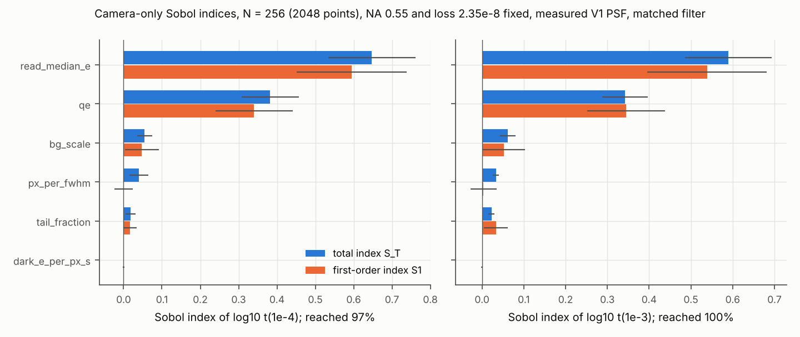

# P1 camera-only Sobol analysis (interim, N = 256)

Status: interim. Computed from the first 2048 rows of the N = 1024 camera-only Saltelli design
(`configs/production/sobol_camera_points_n1024.csv`; the first 8N rows are the nested N design).
The remaining rows are prepared for SLURM (`runs/production/slurm_submit_measpsf.sh`). All numbers
are SIM (review before submission) unless marked DERIVED.

## Result

With NA (0.55) and loss per photon (2.35e-8) fixed at the reference, read-noise median and QE explain
about 95% of the variance of log10 t over the sampled camera space, and the response is additive
(sum of S1 = 0.97 at 1e-3 and 1.00 at 1e-4). Background, pixel sampling and read-noise tail fraction
contribute 2 to 6% each; dark current contributes nothing. However, the variance ranking (read noise
above QE) is a property of the sampled ranges. At the operating point of a realistic Stage 1 sensor
(QE about 0.5, reference background), QE is the stronger lever: t scales as 1/QE, while lowering the
read-noise median below 0.5 e- gains less than 10%. In addition, read-noise tail pixels, which carry
almost no variance over the whole space, slow a 1 e- camera by 42% at a 2% tail fraction.

## Setup

Here, the output is log10 of the imaging time t at which the matched-filter error first reaches 1e-3
or 1e-4, with survival >= 0.99, in the reference Cs scenario (`configs/production/reference_cs.yaml`)
with the measured V1 PSF. Scan from 1 ms to 5 s; at the reference loss survival stays >= 0.99 up to
5.9 s (DERIVED: 0.01005 / (2.35e-8 x 72300 s^-1)), so only targets slower than 5 s are censored (at
log10 t = 0, as in the 8-parameter design). Six inputs, sampled uniformly (log-uniformly where marked)
over the same ranges as the 8-parameter design (`configs/production/sobol_camera_problem.yaml`): qe
[0.2, 0.95]; read_median_e [0.1, 4] e- (log); tail_fraction [0, 0.05] (tail pixels at 5x the median);
px_per_fwhm [0.35, 2] (log); bg_scale [0.1, 3] (log, multiplying 4.76 e-/px/s at the V1 pixel);
dark_e_per_px_s [1e-3, 3] (log). Cost: 11.0 CPU-h for 2048 points.

## Indices (95% bootstrap confidence intervals from SALib)

| parameter (ranked by S_T for 1e-4) | S1, t(1e-4) | S_T, t(1e-4) | S1, t(1e-3) | S_T, t(1e-3) |
|---|---|---|---|---|
| read_median_e | 0.595 +- 0.148 | 0.648 +- 0.116 | 0.539 +- 0.125 | 0.589 +- 0.094 |
| qe | 0.340 +- 0.096 | 0.383 +- 0.080 | 0.345 +- 0.089 | 0.342 +- 0.060 |
| bg_scale | 0.047 +- 0.050 | 0.055 +- 0.021 | 0.053 +- 0.045 | 0.062 +- 0.021 |
| px_per_fwhm | -0.000 +- 0.024 | 0.040 +- 0.019 | 0.004 +- 0.030 | 0.033 +- 0.008 |
| tail_fraction | 0.017 +- 0.016 | 0.018 +- 0.017 | 0.033 +- 0.027 | 0.023 +- 0.006 |
| dark_e_per_px_s | 0.000 +- 0.001 | 0.000 +- 0.000 | -0.000 +- 0.002 | 0.000 +- 0.000 |

Fraction of points reaching the target within 5 s: 1.000 (1e-3), 0.969 (1e-4). All 63 unreached points
have read_median_e of 1.86 e- or more. Median t over the design: 29.7 ms (1e-3), 46.3 ms (1e-4).

## Main effects

Because the response is additive, the conditional geometric mean of t in bins of one input (all other
inputs averaged over their ranges) is informative. Table C-1 gives it relative to the fastest bin, for
reached points (the slowest read-noise and QE bins are therefore slightly optimistic at 1e-4).

**Table C-1. Main effect on t(1e-4) [t(1e-3)], relative to the fastest bin.**

| read_median_e (e-) | 0.1-0.2 | 0.2-0.3 | 0.3-0.5 | 0.5-0.7 | 0.7-1.0 | 1.0-1.4 | 1.4-2.0 | 2.0-2.8 | 2.8-4.0 |
|---|---|---|---|---|---|---|---|---|---|
| factor | 1.00 [1.00] | 1.04 [1.05] | 1.16 [1.18] | 1.41 [1.43] | 1.68 [1.70] | 2.10 [2.10] | 2.81 [2.76] | 3.53 [3.61] | 4.34 [4.99] |

| qe | 0.2-0.3 | 0.3-0.4 | 0.4-0.5 | 0.5-0.6 | 0.6-0.7 | 0.7-0.8 | 0.8-0.95 |
|---|---|---|---|---|---|---|---|
| factor | 2.90 [3.39] | 2.47 [2.56] | 1.94 [1.96] | 1.62 [1.61] | 1.29 [1.29] | 1.17 [1.16] | 1.00 [1.00] |

| px_per_fwhm | 0.35-0.5 | 0.5-0.7 | 0.7-1.0 | 1.0-1.4 | 1.4-2.0 |
|---|---|---|---|---|---|
| factor | 1.14 [1.07] | 1.02 [1.00] | 1.04 [1.01] | 1.00 [1.01] | 1.07 [1.18] |

| bg_scale | 0.1-0.3 | 0.3-1.0 | 1.0-3.0 |
|---|---|---|---|
| factor | 1.00 [1.00] | 1.10 [1.07] | 1.41 [1.36] |

## Local sensitivities at the Stage 1 operating point

The main effects average over the background range, whose log-uniform median (bg_scale 0.55) is
darker than the reference, and over all sampling and QE values. Read noise weighs more in dark
conditions. Hence, for a specification, we evaluated the same model at fixed points: px_per_fwhm 1.0,
bg_scale 1.0 (reference background), no tail, dark 0.01 e-/px/s unless stated.

**Table C-2. t(1e-3) / t(1e-4) in ms versus read-noise median, at the reference background.**

| QE | 0.1 e- | 0.25 e- | 0.5 e- | 1.0 e- | 2.0 e- |
|---|---|---|---|---|---|
| 0.485 | 20.1 / 31.4 | 20.7 / 32.0 | 22.6 / 34.1 | 28.1 / 40.7 | 41.5 / 57.8 |
| 0.85 | 11.5 / 17.8 | 11.8 / 18.2 | 12.9 / 19.3 | 16.0 / 23.0 | 23.6 / 32.7 |

**Table C-3. Read-noise tail at QE 0.485, median 1.0 e-, dark 1.5 e-/px/s (Prime BSI Express CMS).**

| tail fraction (tail pixels at 5x median) | 0 | 0.02 | 0.05 |
|---|---|---|---|
| t(1e-3) / t(1e-4) (ms) | 28.4 / 41.3 | 38.0 / 58.7 | 44.0 / 65.8 |

Cross-check: the generic model at the preset parameters reproduces the preset results (Prime BSI
Express CMS 41.3 ms, as in the preset sweep; ORCA-Quest 2 PNR, median 0.25 e-, QE 0.384, 39.3 ms
against 40.2 ms for the preset, whose read-noise model has a 3x tail class).

## Reading

(i) Over the camera-side space, read noise and QE are the only first-order inputs, and they act
additively on log t. Background matters at the 1.4x level across a 10x range of stray light; sampling
anywhere from 0.5 to 1.4 px per FWHM is within 4% of the best; dark current up to 3 e-/px/s is
irrelevant at these imaging times.

(ii) The variance ranking says read noise explains more of the spread than QE. This is because the
read-noise range spans a factor of 40 (0.1 to 4 e-), including cameras that are clearly unsuitable,
while QE spans a factor of 4.75. It does not mean that a Stage 1 sensor near 1 e- gains more from
lower read noise than from higher QE. At QE 0.485 and the reference background (Table C-2), lowering
the median from 1.0 to 0.25 e- shortens t(1e-4) by a factor of 1.27; raising QE to 0.85 at 1.0 e-
shortens it by 1.77, close to the QE ratio of 1.75. Below 0.5 e- the read-noise gain is under 10%.

(iii) Variance-based indices understate inputs that matter only in part of the space. The tail
fraction has S_T of about 0.02, yet at a 1 e- median a 2% tail raises t(1e-4) by 42% (Table C-3),
because tail pixels at 5x the median are harmful only when the median is already near 1 e-.

(iv) Compared with the 8-parameter design (`reports/p1_sobol_interim_n256.md`), removing NA and loss
removes the censoring problem (3% unreached instead of 31% at 1e-4) and makes the camera-side ranking
unambiguous: read noise and QE, then background, sampling and tails, with dark current negligible.

## Implications for the Stage 1 specification (provisional, reference scenario)

QE at 852 nm is the main lever; every gain in QE shortens the imaging time in proportion. A read-noise
median of 0.5 e- or below is within 10% of an ideal sensor; at 1.0 e- the penalty is about 30%, and at
2.0 e- about 80%. The fraction of pixels with read noise well above the median must be kept well below
2%, or such pixels masked; this needs the measured read-noise distribution from P4. Cooling need only
keep dark current below about 1 e-/px/s. Magnification should give 0.5 to 1.4 px per FWHM.

## Limitations

N = 256 gives half-widths of 0.06 to 0.15 on the two leading indices. Tail pixels are a two-class
model at 5x the median (P4 will supply the distribution). Results hold for the reference scenario
(NA 0.55, measured V1 PSF, reference background and loss) and the matched filter.
