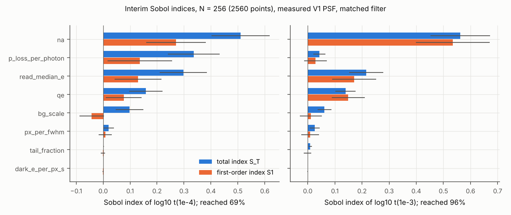

# P1 Sobol analysis: interim result at N = 256

Status: interim. Computed from the first 2560 rows of the N = 1024 Saltelli design
(`configs/production/sobol_points_n1024.csv`). These rows are exactly the N = 256 design
(SALib 1.6.0, same seed; checked row by row). The full design (10240 points) is prepared for
SLURM (`runs/production/slurm_submit_measpsf.sh`). All numbers below are SIM (review before
submission).

## Setup

Here, the output is log10 of the imaging time t at which the matched-filter error eps(t) first
reaches 1e-3 or 1e-4, subject to survival >= 0.99, in the reference Cs scenario
(`configs/production/reference_cs.yaml`) with the measured V1 PSF (Gaussian waist 1.44 um at
NA 0.55, rescaled as 1/NA). Time scan from 1 ms to 1 s. A point that does not reach the target
within 1 s, or only after survival has fallen below 0.99, is censored at log10 t = 0.
Eight inputs, sampled uniformly (log-uniformly where marked) over the ranges in
`configs/production/sobol_problem.yaml`: qe [0.2, 0.95]; read_median_e [0.1, 4] e- (log);
tail_fraction [0, 0.05]; px_per_fwhm [0.35, 2] (log); bg_scale [0.1, 3] (log); dark
[1e-3, 3] e-/px/s (log); na [0.3, 0.8]; p_loss_per_photon [2e-9, 6e-7] (log).
Cost: 20.3 CPU-h for the 2560 points.

## Indices (95% bootstrap confidence intervals from SALib)

| parameter (ranked by S_T for 1e-4) | S1, t(1e-4) | S_T, t(1e-4) | S1, t(1e-3) | S_T, t(1e-3) |
|---|---|---|---|---|
| na | 0.270 +- 0.119 | 0.510 +- 0.124 | 0.535 +- 0.119 | 0.562 +- 0.130 |
| p_loss_per_photon | 0.136 +- 0.114 | 0.336 +- 0.085 | 0.028 +- 0.043 | 0.043 +- 0.023 |
| read_median_e | 0.129 +- 0.077 | 0.298 +- 0.082 | 0.171 +- 0.078 | 0.216 +- 0.066 |
| qe | 0.076 +- 0.074 | 0.158 +- 0.065 | 0.149 +- 0.054 | 0.140 +- 0.037 |
| bg_scale | -0.043 +- 0.039 | 0.098 +- 0.049 | 0.012 +- 0.042 | 0.062 +- 0.028 |
| px_per_fwhm | 0.008 +- 0.020 | 0.021 +- 0.019 | 0.009 +- 0.030 | 0.026 +- 0.020 |
| tail_fraction | -0.001 +- 0.008 | 0.002 +- 0.001 | -0.001 +- 0.014 | 0.009 +- 0.006 |
| dark_e_per_px_s | -0.000 +- 0.002 | 0.000 +- 0.000 | -0.000 +- 0.002 | 0.000 +- 0.000 |

Fraction of points reaching the target: 0.957 (1e-3), 0.690 (1e-4).
Sum of S1: 0.91 (1e-3), 0.58 (1e-4).

Fraction reaching 1e-4 (and 1e-3) by quartile of the input:

| input | Q1 | Q2 | Q3 | Q4 |
|---|---|---|---|---|
| na (0.30 to 0.80) | 0.47 (0.85) | 0.63 (0.97) | 0.78 (1.00) | 0.88 (1.00) |
| p_loss_per_photon (2e-9 to 6e-7) | 0.99 (1.00) | 0.91 (1.00) | 0.63 (0.98) | 0.22 (0.84) |
| qe (0.20 to 0.95) | 0.60 (0.91) | 0.69 (0.96) | 0.72 (0.98) | 0.75 (0.98) |
| read_median_e (0.1 to 4 e-) | 0.78 (0.97) | 0.75 (0.97) | 0.68 (0.97) | 0.55 (0.92) |
| bg_scale (0.1 to 3) | 0.74 (0.97) | 0.69 (0.98) | 0.68 (0.95) | 0.65 (0.93) |

## Reading

(i) At 1e-3 the response is close to additive (sum of S1 = 0.91). NA dominates (S_T = 0.56),
followed by read noise (0.22) and QE (0.14). This is because the collection fraction
(isotropic emission) runs from 0.023 at NA 0.3 to 0.200 at NA 0.8 (DERIVED, `optics/collection.py`),
a factor of 8.7 in signal rate, against a factor of 4.75 over the QE range.

(ii) At 1e-4 the sum of S1 drops to 0.58 and the S_T of loss rises to 0.34. Most of this is
censoring: 31% of points do not reach 1e-4 before survival falls below 0.99, and reachability
is set mainly by p_loss and NA (table above). The 1e-4 indices therefore mix two questions,
how fast the target is reached and whether it is reached at all, and the second depends on the
arbitrary censoring value (1 s). A Sobol analysis of the 0/1 reached indicator for 1e-4,
from the same points, confirms this: S_T = 0.73 +- 0.15 (p_loss), 0.41 +- 0.11 (na),
0.24 +- 0.10 (read_median_e), 0.14 +- 0.07 (qe), 0.13 +- 0.08 (bg_scale), <= 0.03 for the rest.
Loss alone sets whether 1e-4 is reachable far more than it sets t(1e-3). (The same analysis at
1e-3, where only 4% of points are censored, gives intervals of +-0.1 to +-0.3 and is not informative.)

(iii) Over these ranges, pixel sampling (S_T 0.02 to 0.03), read-noise tail fraction (<= 0.01)
and dark current (0.000) are negligible. For dark current this follows from the short imaging
times: median t(1e-3) = 37 ms, so even 3 e-/px/s contributes about 0.1 e-/px.

(iv) The indices are conditional on the input ranges. NA and p_loss are properties of the
experiment, not the camera, and their wide ranges absorb most of the variance. For camera
selection the relevant comparison is among qe, read_median_e, bg_scale and px_per_fwhm, where
read noise ranks above QE at both targets in this design, although the intervals overlap at 1e-3.

## Limitations

N = 256 gives confidence half-widths of 0.04 to 0.13 on the leading indices; small negative S1
values (bg_scale at 1e-4) are estimator noise. The ranking of na, p_loss and read_median_e at
1e-4 overlaps within the intervals. The full N = 1024 design should halve these widths.
