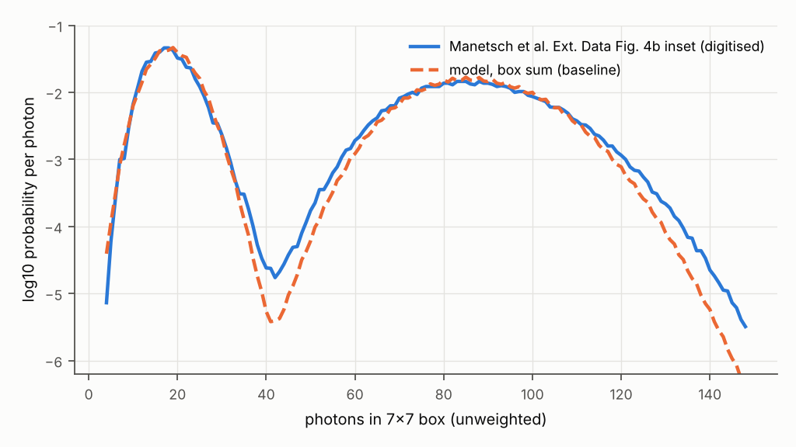
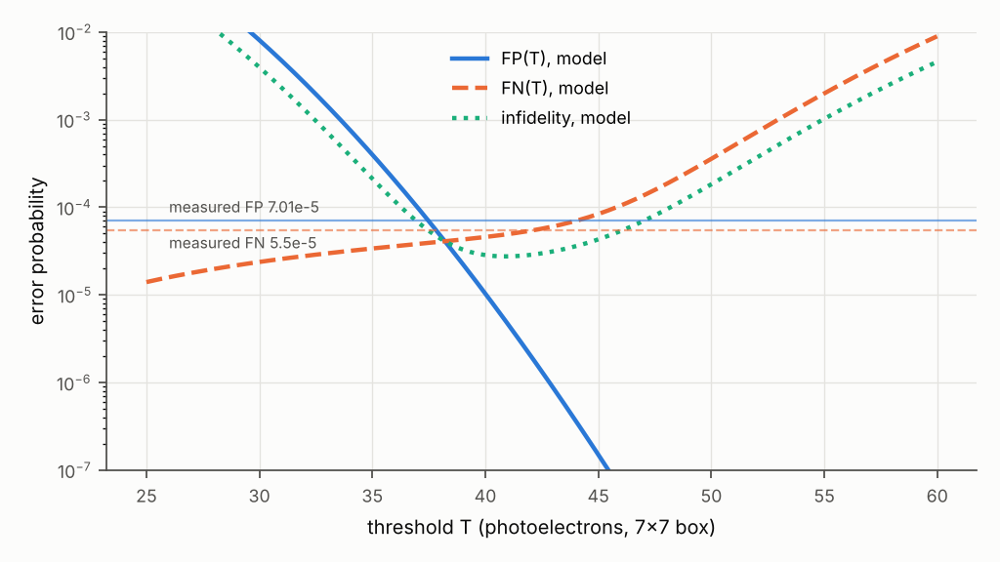
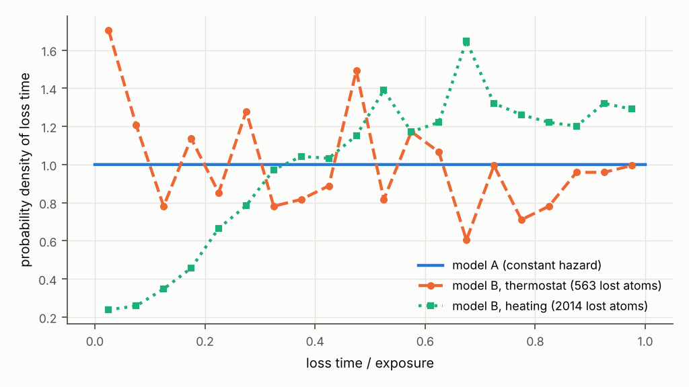
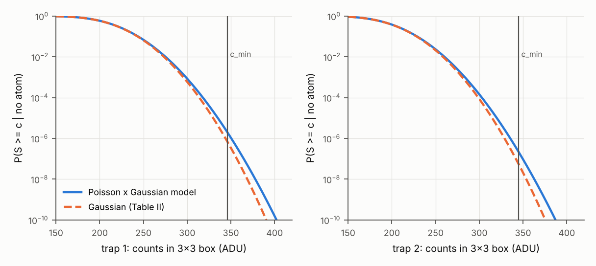

# P1 validation report: single-atom detection model, stages V1 to V3

CAQSAT lab, IIT Madras. Status: validation stage complete; production sweeps not started
(awaiting the check-in required by rule 7). Generated by `python -m p1_atomdet.validation.report`
from the run outputs in `runs/validation/`; every number below is read from those files.

## Summary

We built a semi-analytic model of single-atom detection that maps a `SensorModel` camera
description, the atom's photon budget and its loss during imaging to false-positive (FP) and
false-negative (FN) rates, and validated it against two published experiments and a set of
analytic limits.

1. **Manetsch et al. (V1, ORCA-Quest, 80 ms).** With the paper's QE, transmission, exposure,
   PSF and survival fixed, the histogram means and the read noise fitted, and the per-site rate
   distribution taken from the paper's own figure, the model reproduces the measured FN rate to
   within 11% (4.91e-5 against 5.50e-5; a Gaussian rate distribution gives
   5.73e-5) and the log-scale histogram over four decades. It under-predicts the FP rate by a factor
   of 14 (4.85e-6 against 7.01e-5), so the predicted fidelity, 0.9999725, exceeds the measured
   0.9999374(8). The digitised histogram shows the corresponding excess directly: between 32 and
   42 photons the measured background tail lies 2 to 3 times above any Poisson-plus-read-noise
   model consistent with the background width. The FP floor of that experiment is therefore set
   by events outside a camera model (Sec. 3.3), not by the sensor.
2. **Picken et al. (V2, Zyla 5.5, 40 ms).** Fitting only the ADC gain and the background to the
   background peak of each trap gives gains that agree between the two traps
   (0.381 and 0.368 e-/ADU), and trap 1's atom signal then agrees with the stated
   photon budget to 5% (trap 2 is 32% brighter). At the paper's threshold the
   Poisson background gives a readout error 2.9 and 4.0 times larger than the paper's Gaussian
   estimate (9.55e-7 for trap 1, just above the quoted bound of 8e-7). The SNR table
   (their Table I) is reproduced cell by cell to 0.05 except two cells of the EMCCD 852 nm
   column (100 and 1000 photons/px), which are consistent with QE = 0.55 rather than the stated 0.60.
3. **Analytic limits (V3).** Pure Poisson discrimination is reproduced to 4.42e-14 relative error;
   the stage-by-stage EMCCD Monte Carlo reproduces the finite-register excess noise of Basden et al.
   (F^2 = 1.972 at gain 1000 and 512 stages, tending to 2); dipole collection, the vectorial PSF and the
   Langevin integrator pass their limits.

The main limitation is that the dominant measured error term in V1 (FP) is not explained by the
model, and two parameters that matter at the 1e-5 level, the low tail of the scattering-rate
distribution and the time profile of atom loss, are constrained only by figure digitisation and
by an assumed loss model. These are quantified in Sec. 3.4.

## 1. Scope

This report covers the shared package `camsim_common` and P1 up to the validation stage, as
agreed for this session: V1 (Manetsch et al., arXiv:2403.12021v4), V2 (Picken et al.,
arXiv:1709.00946v2), V3 (analytic limits) and a convergence study. Camera presets for the eight
production cameras, the generic sweep, the Sobol analysis, the Stage 1 specification and the
Prime BSI Express recipe are deferred until after this check-in. Sources, versions and file
hashes are listed in `sources/README.md`.

## 2. Model

**Photon budget.** An atom present for the whole exposure t yields
mu = R t eta_cam QE detected electrons. Here, R is the scattering rate, eta_cam the fraction of
scattered photons reaching the sensor and QE the quantum efficiency. For sweeps R follows the
two-level formula R = (Gamma/2) s/(1 + s + 4 Delta^2/Gamma^2) with Gamma from Steck
(Cs: 32.889(84)e6 s^-1; Rb87: 38.117(11)e6 s^-1), and eta_cam = eta_coll(NA) eta_opt with the
closed-form dipole collection fractions of `optics/collection.py` (DERIVED; V3).

**Loss.** Both loss models reduce to the distribution of the fraction tau of the exposure during
which the atom is present. Model A is a constant hazard L = p_ph R t + t/tau_vac, so
S = exp(-L) and tau is truncated-exponential. Model B integrates a 3D Langevin walk in a
Gaussian-beam trap (recoil kicks on absorption and emission, an Ornstein-Uhlenbeck thermostat,
loss when the energy exceeds the trap depth). We derived the lossy-Poisson histogram model of
Manetsch et al. independently (Methods of that paper); it differs from our tau-mixture only by
the convention that the loss-triggering photon is counted, a difference of
4.45e-7 in the PMF and 1.98e-6 in the CDF at the V1 threshold.

**Count statistics.** For each pixel we build the exact output distribution on a lattice:
Poisson electrons (signal x (1 + PRNU) + background + dark), a Gaussian-mixture read noise
(core plus RTS classes, per-pixel class or ensemble), ADC rounding and full-well clipping; or,
for an EMCCD, the Erlang or finite-register gamma output with clock-induced charge generated
before or inside the register, read noise and an optional photon-counting threshold. The pixel
outputs are mapped through the classifier's score (box sum, matched filter, or per-pixel
log-likelihood ratio) and convolved over the box. Loss time tau and the rate multiplier m enter
only through s = tau m, so the atom-present distribution is a mixture over a uniform grid in s
(step ds) of convolutions; neighbour occupancy is a further mixture. Error rates of 1e-6 and
below are thus computed without sampling. Brute-force Monte Carlo (agreement within the 95%
Clopper-Pearson interval at error rates near 1e-3, `tests/test_counts.py`) and exponentially
tilted importance sampling (Table V1-e, Appendix A) check the engine.

## 3. V1: Manetsch et al. (Cs, ORCA-Quest C15550-20UP, 80 ms)

### 3.1 Inputs

Fixed from the paper (SOURCE): QE 0.44 at 852 nm and "around 2.7% of scattered photons entering
the camera", which excludes QE (Methods, "Single-atom imaging"); 80 ms; magnification 5.1; PSF
waist 1.7 px (measured); 7x7 box; filling 0.512; model-free imaging survival S = 0.999864(2),
which sets L = 1.36e-4. Taken from the paper's figures (DATA): the background and atom histogram
moments of Ext. Data Fig. 4b (background 18.66 +- 4.40, atom 87.40 +- 13.22 photons) and the
per-site scattering-rate histogram of Ext. Data Fig. 4d (mean 69.7 kc/s, relative spread
0.123). Digitisation method and resolution are given in `sources/README.md`. The pixel pitch,
4.6 um, is DERIVED from the paper (7.8 um = 1.7 px). The camera read noise and ADC gain are not
stated in the paper; the read noise is fitted (below) and the ADC gain is a placeholder whose
effect is bounded by the PNR variant.

**Table V1-a. Fitted parameters.**

| parameter | value | how obtained |
|---|---|---|
| lambda0 (e-, 7x7 box) | 18.7 | fitted: background mean (DATA) |
| mu (e-, atom present all exposure) | 68.7 | fitted: atom minus background mean (DATA) |
| sigma_read (e- rms) | 0.115 | fitted to background width |
| rate distribution | Fig. 4d histogram | DATA (not fitted); Gaussian with rel. sd 0.1226 as variant |
| loss hazard L | 1.36e-4 | DERIVED: -ln S, S = 0.999864 (SOURCE) |

The fitted read noise, 0.115 e- rms, is below the 0.43 e- standard-scan value we hold for the
ORCA-Quest 2 (USER table) and below any ORCA-Quest value we know of; the background width is
within 2% of the pure Poisson value sqrt(18.66) = 4.32. We read this as either a low-noise scan mode
or processing of the published histogram, and carry sigma = 0.43 e- as a variant.

### 3.2 Predictions and residuals

**Table V1-b. Predicted error rates.** Threshold optimised for each row at filling 0.512.
Variants change one assumption relative to the baseline (empirical rate distribution, model A
loss, fitted read noise, ADC step 0.107 e-).

| variant | classifier | threshold | FP | FN | fidelity | atom sd (e-) |
|---|---|---|---|---|---|---|
| baseline | box | 40.98 | 4.85e-6 | 4.91e-5 | 0.9999725 | 12.66 |
| baseline | matched | 18.16 | 1.58e-6 | 2.90e-5 | 0.9999844 | 10.74 |
| baseline | bayes | -18.09 | 1.49e-6 | 2.73e-5 | 0.9999853 | - |
| gaussian_rate | box | 40.02 | 1.05e-5 | 5.73e-5 | 0.9999656 | 12.63 |
| no_rate_spread | box | 41.73 | 2.62e-6 | 4.66e-5 | 0.9999749 | 9.40 |
| sigma_0.43_spec | box | 42.37 | 1.71e-5 | 6.92e-5 | 0.9999562 | 12.98 |
| pnr_rounding | box | 41.00 | 5.35e-6 | 4.72e-5 | 0.9999732 | 12.63 |
| no_loss | box | 41.52 | 3.13e-6 | 4.57e-6 | 0.9999961 | 12.65 |
| no_loss | matched | 21.48 | 7.07e-9 | 1.12e-8 | 1.0000000 | 10.73 |
| no_loss | bayes | -7.41 | 3.92e-9 | 6.50e-9 | 1.0000000 | - |
| model_B_thermostat | box | 40.98 | 4.85e-6 | 5.42e-5 | 0.9999699 | 12.66 |
| model_B_heating | box | 40.98 | 4.85e-6 | 2.83e-5 | 0.9999831 | 12.65 |

**Table V1-c. Residuals against the measurement (box classifier, baseline).**

| quantity | measured (SOURCE) | model (box, baseline) | model/measured |
|---|---|---|---|
| FP | 7.01e-5 | 4.85e-6 | 0.0692 |
| FN | 5.50e-5 | 4.91e-5 | 0.893 |
| infidelity | 6.26e-5 | 2.75e-5 | 0.439 |
| fidelity | 0.9999374 | 0.9999725 | - |
| atom-peak sd (e-, DATA) | 13.2 | 12.7 | 0.957 |
| scattering rate (kc/s, DATA mean vs implied) | 69.7 | 72.3 | 1.04 |
| no-loss fidelity | paper (lossy-Poisson fit, loss set to 0) | model (box) |
|---|---|---|
|  | 0.99999(1) | 0.999996 |

The implied scattering rate, 72.3 kc/s, is 3.7% above the mean of the per-site rate histogram;
both use the same 2.7% and 44%, so this residual tests only the internal consistency of the
paper's numbers and our digitisation.

*Figure 1. Box-sum photon distribution for V1 on a log scale. Blue: Ext. Data Fig. 4b inset of
Manetsch et al., digitised from a 400 dpi render (axis calibration on the 0, 100 and 1e-3, 1e-6
ticks; resolution about 0.04 decades). Orange dashed: model mixture (1 - F) P(S|0) + F P(S|1) with
F = 0.512, background 18.66 e- per box, mu = 68.75 e-, read noise 0.115 e- rms per pixel, ADC step
0.107 e-, empirical rate distribution (Ext. Data Fig. 4d), model-A loss with S = 0.999864. The
model is not fitted to this curve.*

*Figure 2. FP(T), FN(T) and infidelity versus threshold for the V1 baseline (box sum, same
parameters as Fig. 1), computed on the lattice (step 0.107 e-). Horizontal lines: the measured
FP = 7.01(8)e-5 and FN = 5.5(1)e-5 (model-free analysis of Manetsch et al.).*

### 3.3 The false-positive deficit

At the optimal threshold the model's FP rate is 4.85e-6, against 7.01e-5 measured. Raising the read noise
to 0.43 e- moves it to 1.71e-5; a Gaussian rather than empirical rate distribution changes the
threshold and gives 1.05e-5. Neither approaches the measurement while keeping the background width
of Fig. 4b. Fig. 1 locates the discrepancy: from 32 to 42 photons the measured density is 2 to 3
times the model's. Candidate causes, none of which is a camera property, are (i) atoms entering a
site during imaging (the paper reports lower fidelity in the first image and attributes it to
residual vapour), (ii) background that varies between sites or shots with a non-Gaussian tail,
and (iii) the three-image model-free estimator attributing some loss-recapture sequences to FP.
Neighbour crosstalk is negligible at 7.2 um spacing with a 1.5 um waist (the Gaussian tail at
4 um from the neighbour is ~1e-6 of its light), and cosmic-ray hits on a 7x7 box are ~1e-8 per
image. We therefore regard V1 as validating the camera-and-atom part of the model (FN, histogram
shape, no-loss fidelity) and report the FP excess as an experimental floor that the camera
specification cannot remove.

### 3.4 Sensitivity to the loss model and to the rate distribution

At fixed survival S = 0.999864, the loss-time profile changes FN by -42% (model B,
heating-dominated, losses late in the exposure) to +10% (model B, escape from a cooled
equilibrium) relative to model A (Fig. 3). Model B was run in regimes with measurable loss
(trap depth 0.18 mK from the paper; waist, damping rate and thermostat temperature are placeholders)
and only the normalised loss-time shape was transferred to the measured survival. The rate
distribution matters at the same level: replacing the empirical Fig. 4d histogram by a Gaussian of
the same mean and width raises FN from 4.91e-5 to 5.73e-5, because a Gaussian puts more sites in the
low-rate tail than the histogram shows. Without loss the box classifier reaches F = 0.999996,
consistent with the paper's lossy-Poisson estimate of 0.99999(1) for zero loss; the matched filter
and the Bayesian classifier then reach 0.99999999 and better, so the loss term, not photon
statistics, limits this experiment.

*Figure 3. Distribution of the loss time of lost atoms, as a fraction of the 80 ms exposure.
Model A: constant hazard, L = 1.36e-4. Model B: Langevin walk in a Gaussian-beam trap
(U0 = 0.18 mK, w0 = 0.55 um, zR = 0.9 um; placeholders except U0), 4000 atoms, dt = 0.5 us;
thermostat regime R = 72 kc/s, damping 1e4 s^-1, T_eq = 10 uK on three axes; heating regime
R = 7 kc/s without cooling. Histograms with 20 bins.*

### 3.5 Independent checks

**Table V1-e. Lattice versus importance sampling (Gaussian-rate variant, box, optimal threshold).**

| Gaussian-rate box, T = 40.02 e- | lattice (SIM) | importance sampling (SIM) | IS rel. error | ESS |
|---|---|---|---|---|
| FP | 1.05e-5 | 1.05e-5 | 0.00377 | 5.99e+04 |
| FN | 5.73e-5 | 5.84e-5 | 0.00829 | 1.4e+04 |

**Table V1-f. Our tau-mixture versus the paper's lossy-Poisson formula (pure Poisson, same lambda0, lambda1, L).**

| check | value |
|---|---|
| max |P_paper(n) - P_ours(n)|, pure Poisson | 4.45e-7 |
| |CDF difference| at threshold | 1.98e-6 |

## 4. V2: Picken et al. (Cs, Andor Zyla 5.5, 40 ms)

### 4.1 Fit and photon budget

Fixed (SOURCE): QE 0.22, read noise 2.2 e- rms, 40 ms, detection efficiency 3.5% excluding QE, an
effective scattering rate of 450 photons/ms, a 3x3 box of 1 um object-plane pixels and a PSF of
0.7 um (taken as a Gaussian FWHM; the box then holds >99.9% of the light). Table II of the paper
gives the background and atom peaks in camera counts; we assume the offset is subtracted, since
mu0 = 206 counts is below any plausible 9-pixel offset. For each trap the ADC gain g and the
background lambda0 follow in closed form from the background mean and width,
sigma0^2 g^2 = lambda0 + 9 sigma_r^2 + 9 g^2/12 with lambda0 = mu0 g; the lattice model then
reproduces mu0 and sigma0 exactly (Table V2-a, row 4). The predicted atom signal is
R t eta QE = 138.6 e-.

**Table V2-a. Fit and photon budget.**

| quantity | trap 1 | trap 2 |
|---|---|---|
| detection efficiency 5.4% x 79% x 83% (DERIVED) vs 3.5% stated | 0.0354 | - |
| fitted ADC gain g (e-/ADU) | 0.381 | 0.368 |
| fitted background lambda0 (e-, 3x3) | 78.5 | 70.3 |
| model mu0 / sigma0 (ADU) [paper 206/29, 191/29] | 206.0 / 29.00 | 191.0 / 29.00 |
| atom signal, measured (e-) | 145 | 182 |
| atom signal, predicted R t eta QE (e-) | 139 | 139 |
| measured / predicted | 1.05 | 1.32 |
| fitted relative signal spread | 0.0551 | 0.0848 |

The two independently fitted gains agree to 3.5%, as they must for one camera. Trap 1 matches
the stated photon budget; trap 2 is 32% brighter, which the paper's remark about a standing wave
reducing the rate in trap 1 explains only qualitatively, since the 450 photons/ms is not stated per
trap. The atom peaks are wider than Poisson; the excess corresponds to a relative signal spread of
0.055 (trap 1) and 0.085 (trap 2), fitted.

### 4.2 Readout error

**Table V2-b. Error rates at the paper's thresholds and at the model's optimum.**

| quantity | trap 1 | trap 2 |
|---|---|---|
| threshold c_min (ADU) [paper] | 346 | 345 |
| eps, paper Eq. (4) Gaussian (DERIVED from Table II) | 3.32e-7 | 2.35e-8 |
| eps = p0 FP, Poisson x Gaussian model (SIM) | 9.55e-7 | 9.32e-8 |
| model / Gaussian | 2.88 | 3.96 |
| acceptance, paper Eq. (5) (DERIVED from Table II) | 0.9999987 | 0.9999998 |
| acceptance, model incl. vacuum loss at tau_vac = 6 s (SIM) | 0.99753 | 0.99790 |
| optimal threshold (ADU), model | 315 | 300 |
| optimal FP / FN, model | 1.45e-04 / 1.92e-03 | 1.45e-04 / 1.49e-03 |

The paper's error, epsilon = p0 P(S > c_min | no atom), uses a Gaussian for the background. The
Poisson background with Gaussian read noise has a heavier upper tail (Fig. 4), and at the paper's
thresholds gives 2.9 and 4.0 times the Gaussian value. For trap 1 this is 9.55e-7, just above
the quoted bound of 8e-7; the bound holds for trap 2. The paper's acceptance (Eq. 5) ignores loss
during the exposure; with the measured lifetime bound (>6 s) the model gives an acceptance of
0.9975 and 0.9979, an upper bound on the loss contribution because the lifetime is a lower bound.
The retention of >99% per image is consistent with loss model A at that lifetime.

*Figure 4. Probability that the 3x3 background sum reaches c (counts), for the two traps of Picken
et al. Blue: our model, Poisson background lambda0 and 2.2 e- Gaussian read noise per pixel with
ADC rounding at the fitted gain (trap 1: lambda0 = 78.5 e-, g = 0.381 e-/ADU; trap 2: 70.3 e-,
0.368 e-/ADU). Orange dashed: the Gaussian of Table II (mu0, sigma0). Vertical line: the paper's
threshold c_min. Both curves have the same mean and width by construction.*

### 4.3 SNR table

**Table V2-c. Table I of Picken et al. recomputed from Eq. (1) and from our sensor chain (moments of
the simulated single-pixel output, n_b = 0).**

| detector | QE | photons/px | Table I | Eq. (1) | sensor chain (SIM) | chain - Table I |
|---|---|---|---|---|---|---|
| Zyla | 0.6 | 10 | 1.8 | 1.82 | 1.82 | 0.0224 |
| Zyla | 0.6 | 100 | 7.4 | 7.45 | 7.45 | 0.0513 |
| Zyla | 0.6 | 1e+03 | 24.4 | 24.4 | 24.4 | -0.00331 |
| Zyla | 0.22 | 10 | 0.8 | 0.829 | 0.829 | 0.0292 |
| Zyla | 0.22 | 100 | 4.2 | 4.25 | 4.25 | 0.0465 |
| Zyla | 0.22 | 1e+03 | 14.7 | 14.7 | 14.7 | -0.0281 |
| EMCCD | 0.9 | 10 | 2.1 | 2.12 | 2.12 | 0.0208 |
| EMCCD | 0.9 | 100 | 6.7 | 6.71 | 6.71 | 0.00805 |
| EMCCD | 0.9 | 1e+03 | 21.2 | 21.2 | 21.2 | 0.0131 |
| EMCCD | 0.6 | 10 | 1.7 | 1.73 | 1.73 | 0.0315 |
| EMCCD | 0.6 | 100 | 5.2 | 5.48 | 5.48 | 0.277 |
| EMCCD | 0.6 | 1e+03 | 16.6 | 17.3 | 17.3 | 0.72 |
| CCD | 0.7 | 10 | 0.7 | 0.677 | 0.677 | -0.0233 |
| CCD | 0.7 | 100 | 5.4 | 5.37 | 5.37 | -0.0312 |
| CCD | 0.7 | 1e+03 | 24.7 | 24.7 | 24.7 | 0.0487 |
| CCD | 0.2 | 10 | 0.2 | 0.198 | 0.198 | -0.00197 |
| CCD | 0.2 | 100 | 1.8 | 1.83 | 1.83 | 0.0257 |
| CCD | 0.2 | 1e+03 | 11.5 | 11.5 | 11.5 | 0.047 |

Our chain reproduces Eq. (1) exactly, as it should (Poisson x Gaussian for CMOS/CCD; Erlang
register, F^2 = 2, for the EMCCD). Against the printed table the residuals are within rounding
(0.05) except the EMCCD at 852 nm for 100 and 1000 photons/px, where the printed values
correspond to QE = 0.55 rather than the 0.60 of the caption (DERIVED by inverting Eq. 1).

## 5. V3: analytic limits

**Table V3-a. Pure Poisson discrimination (zero read noise, ADC step 1 e-).**

| mu | B | T | box | FP engine | FP exact | FN engine | FN exact | max rel. dev. |
|---|---|---|---|---|---|---|---|---|
| 10 | 0 | 1 | 1 | 0 | 0 | 4.54e-5 | 4.54e-5 | 1.49e-16 |
| 10 | 0.5 | 3 | 3 | 0.0144 | 0.0144 | 0.00183 | 0.00183 | 4.82e-16 |
| 30 | 2 | 9 | 5 | 2.37e-4 | 2.37e-4 | 4.55e-7 | 4.55e-7 | 2.97e-15 |
| 70 | 18 | 40 | 7 | 5.34e-6 | 5.34e-6 | 3.59e-9 | 3.59e-9 | 4.42e-14 |

**Table V3-b. EMCCD excess noise factor (input Poisson with mean 5).** Stage MC: 2e5 samples,
binomial multiplication at each of 512 stages (Basden et al., App. A). Eq. (5): Basden et al.

| gain | stages r | F^2 Eq. (5) | F^2 Erlang lattice | F^2 stage MC | MC s.e. | (MC - Eq.5)/s.e. |
|---|---|---|---|---|---|---|
| 10 | 512 | 1.89 | 2 | 1.89 | 0.00748 | 0.127 |
| 100 | 512 | 1.97 | 2 | 1.97 | 0.00784 | -0.0877 |
| 1e+03 | 512 | 1.97 | 2 | 1.96 | 0.00769 | -1.38 |
| 3e+03 | 512 | 1.97 | 2 | 1.98 | 0.0078 | 0.904 |

The Erlang form has F^2 = 2 exactly. A real register of r stages has
F^2 = 1/g + 2(1 - 1/g)/(1 + P), P = g^(1/r) - 1, which tends to 2 only as P -> 0; at 512 stages and
gain 1000 it is 1.972. The stage MC agrees with Eq. (5) within its standard error at all gains.

**Table V3-c. Dipole collection fraction.** Closed forms (`optics/collection.py`) against direct
quadrature of the emission pattern; small-NA coefficients and the NA = 1 limit.

| pattern | f(NA = 1) | small-NA coefficient | expected | NA exponent | max |closed - quadrature| |
|---|---|---|---|---|---|
| isotropic | 0.5 | 0.25 | 0.25 | 2 | 1.13e-10 |
| sigma | 0.5 | 0.375 | 0.375 | 2 | 2.73e-10 |
| pi | 0.5 | 0.188 | 0.188 | 4 | 2.08e-10 |

**Table V3-d. Vectorial (isotropic emitter, aplanatic objective) versus Airy PSF.** r0 = 0.61 lambda/NA,
lambda = 852.35 nm, 200 quadrature nodes. The two agree at NA 0.1; at NA 0.8 the vectorial FWHM is
6% larger and the energy inside the Airy radius is lower by 5%, so the Airy fallback is
adequate only for NA below about 0.3.

| NA | FWHM Airy (nm) | FWHM vectorial (nm) | ratio | EE(r0) Airy | EE(r0) vect. | EE(2r0) Airy | EE(2r0) vect. |
|---|---|---|---|---|---|---|---|
| 0.1 | 4.39e+03 | 4.39e+03 | 1 | 0.838 | 0.837 | 0.912 | 0.912 |
| 0.3 | 1.46e+03 | 1.47e+03 | 1.01 | 0.838 | 0.834 | 0.912 | 0.91 |
| 0.5 | 877 | 894 | 1.02 | 0.838 | 0.826 | 0.912 | 0.906 |
| 0.8 | 548 | 582 | 1.06 | 0.838 | 0.794 | 0.912 | 0.889 |

**Table V3-e. Langevin integrator (model B).**

| check | value | expected |
|---|---|---|
| relative energy drift, no scattering (10 ms) | -5.77e-5 | 0 |
| survival, no scattering | 1 | 1 |
| heating in 20 ms at R = 2e4 s^-1 (uK) | 81 | 79.3 |

## Appendix A. Convergence

All variations are about the V1 configuration (Gaussian rate spread; threshold 40.98 e-).

(a) Statistic lattice step for the matched filter (default = ADC step x max weight / 4):

| h / default | h_stat (e-) | FP | FN | eps |
|---|---|---|---|---|
| 4 | 0.107 | 1.70e-6 | 2.90e-5 | 1.57e-5 |
| 2 | 0.0535 | 1.57e-6 | 2.91e-5 | 1.56e-5 |
| 1 | 0.0267 | 1.58e-6 | 2.90e-5 | 1.56e-5 |
| 0.5 | 0.0134 | 1.59e-6 | 2.90e-5 | 1.56e-5 |
| 0.25 | 0.00669 | 1.58e-6 | 2.90e-5 | 1.56e-5 |

(b) Signal-multiplier grid step ds (default 0.01; FN changes by 0.11% from 0.01 to 0.005):

| ds | FP | FN |
|---|---|---|
| 0.04 | 4.84e-6 | 6.80e-5 |
| 0.02 | 4.84e-6 | 6.67e-5 |
| 0.01 | 4.84e-6 | 6.64e-5 |
| 0.005 | 4.84e-6 | 6.63e-5 |
| 0.0025 | 4.84e-6 | 6.63e-5 |

(c) Loss-time quadrature nodes:

| n_tau | FP | FN |
|---|---|---|
| 8 | 4.84e-6 | 6.64e-5 |
| 16 | 4.84e-6 | 6.64e-5 |
| 48 | 4.84e-6 | 6.64e-5 |
| 96 | 4.84e-6 | 6.64e-5 |

(d) Pixel super-sampling (vectorial PSF, NA 0.55, 2 px per FWHM, site offset (0.25, 0.1) px; reference s = 32):

| s | max |frac - ref| | centre pixel rel. dev. |
|---|---|---|
| 2 | 0.00432 | 0.0251 |
| 4 | 0.00104 | 0.00606 |
| 8 | 2.47e-4 | 0.00144 |
| 16 | 4.94e-5 | 2.87e-4 |

(e) PSF quadrature order (NA 0.8, 2 px per FWHM, 7x7 box). Inside the box 16 nodes already suffice;
far tails need more (the encircled-energy test in `tests/test_optics.py` uses 400 nodes out to 40 lambda/NA):

| n_quad | max |frac - ref(512)| |
|---|---|
| 16 | 4.16e-16 |
| 32 | 2.22e-16 |
| 64 | 4.72e-16 |
| 128 | 2.78e-16 |
| 256 | 2.78e-16 |

(f) Importance sampling at a deep background tail; the relative error falls as N^-1/2 and the
estimates scatter about the lattice value with unit-scale normalised deviations:

Deep FP threshold T = 45.58 e-, lattice FP = 9.1427e-08

| samples | IS estimate | rel. error | (IS - lattice)/sigma | ESS |
|---|---|---|---|---|
| 1e+04 | 8.94e-8 | 0.0268 | -0.841 | 1.22e+03 |
| 4e+04 | 9.16e-8 | 0.0134 | 0.137 | 4.88e+03 |
| 1.60e5 | 9.23e-8 | 0.00671 | 1.44 | 1.95e+04 |
| 6.40e5 | 9.10e-8 | 0.00336 | -1.38 | 7.78e+04 |

(g) Langevin time step (thermostat regime of Fig. 3, 4000 atoms): survival changes by
0.007 from 0.5 to 0.25 us, 1.3 standard errors; we use 0.5 us.

| dt (us) | survival | s.e. | T_eff (uK) |
|---|---|---|---|
| 1 | 0.868 | 0.00536 | 11.1 |
| 0.5 | 0.857 | 0.00554 | 11.2 |
| 0.25 | 0.85 | 0.00565 | 11.3 |

(h) Poisson truncation per pixel:

| Poisson tail cut | FP | FN |
|---|---|---|
| 1.00e-10 | 4.84e-6 | 6.64e-5 |
| 1.00e-13 | 4.84e-6 | 6.64e-5 |
| 1.00e-16 | 4.84e-6 | 6.64e-5 |

## Appendix B. Computational cost (this instance, 4 cores)

| stage | wall time (s) | CPU time (s) | peak RSS (MB) |
|---|---|---|---|
| v1_manetsch | 86.6 | 149 | 1.29e+03 |
| v2_picken | 83.9 | 224 | 1.41e+03 |
| v3_analytic | 66.2 | 177 | 1.41e+03 |
| convergence | 180 | 374 | 1.89e+03 |

Reproducibility: two runs of V1 from the same config give identical HDF5 datasets and identical
JSON results (`camsim_common.io.datasets_equal`).

## Assumptions and limitations

(i) The ORCA-Quest read noise and ADC gain in V1 are not from the paper; the read noise is fitted to
a digitised histogram width. (ii) Figure digitisation limits the rate-distribution tail to about
3e-3 of sites, while FN is sensitive to it at the 1e-5 level. (iii) Model B parameters other than
the trap depth are placeholders; only its loss-time shape is used. (iv) Background is Poisson and
uniform per site; V1 suggests a heavier tail in practice. (v) The classifiers use a single
array-wide threshold, as in the measured fidelity; per-site thresholds were not modelled.
(vi) Picken et al. counts are assumed offset-subtracted.

## Next steps (after approval)

Presets for the eight cameras (with `[VALUE?]` fields swept, including the Blackfly S QE at 852 nm);
a reduced local sweep over QE, read-noise median, tail fraction, pixels per FWHM and background with
CPU-hours per point; then the first production status note before the HPC sweeps and Sobol analysis.

## Provenance ledger

### Values in configs and presets (generated by `python -m camsim_common.placeholders --ledger`)

| value | location | type | pointer |
|---|---|---|---|
| single point | camsim_common/presets/orca_quest_c15550_20up_manetsch.yaml: `qe.prov` | SOURCE | Manetsch et al., arXiv:2403.12021v4, Methods 'Single-atom imaging': '44% are detected on the sensor due to the quantum efficiency at 852 nm' |
| [VALUE?: approx. None, verify] | camsim_common/presets/orca_quest_c15550_20up_manetsch.yaml: `qe_780` | PLACEHOLDER | not used in V1 |
| 0.44 | camsim_common/presets/orca_quest_c15550_20up_manetsch.yaml: `qe_852` | SOURCE | Manetsch et al., arXiv:2403.12021v4, Methods 'Single-atom imaging' |
| [VALUE?: approx. 0.0, verify] | camsim_common/presets/orca_quest_c15550_20up_manetsch.yaml: `prnu` | PLACEHOLDER | not stated; effect on V1 tested in the sensitivity table |
| [VALUE?: approx. 0.43 e- rms, verify] | camsim_common/presets/orca_quest_c15550_20up_manetsch.yaml: `read_noise.sigma_e` | PLACEHOLDER | ORCA-Quest 2 standard-scan value from USER table; C15550-20UP value not retrieved |
| [VALUE?: approx. 0.43 e-, verify] | camsim_common/presets/orca_quest_c15550_20up_manetsch.yaml: `read_noise_median_e` | PLACEHOLDER | as sigma |
| [VALUE?: approx. 0.43 e-, verify] | camsim_common/presets/orca_quest_c15550_20up_manetsch.yaml: `read_noise_rms_e` | PLACEHOLDER | as sigma |
| [VALUE?: approx. 0.107 e-/ADU, verify] | camsim_common/presets/orca_quest_c15550_20up_manetsch.yaml: `adc.gain_e_per_adu` | PLACEHOLDER | recalled; V1 works in photoelectrons, quantisation step < 0.25 sigma |
| [VALUE?: approx. 16 bit, verify] | camsim_common/presets/orca_quest_c15550_20up_manetsch.yaml: `adc.adc_bits` | PLACEHOLDER | recalled |
| [VALUE?: approx. 7000 e-, verify] | camsim_common/presets/orca_quest_c15550_20up_manetsch.yaml: `adc.full_well_e` | PLACEHOLDER | recalled; V1 pixel signals < 20 e- |
| [VALUE?: approx. 200 ADU, verify] | camsim_common/presets/orca_quest_c15550_20up_manetsch.yaml: `adc.offset_adu` | PLACEHOLDER | recalled |
| [VALUE?: approx. 0.016 e-/px/s, verify] | camsim_common/presets/orca_quest_c15550_20up_manetsch.yaml: `dark.D_ref` | PLACEHOLDER | recalled; dark over 49 px x 80 ms < 0.07 e- |
| [VALUE?: approx. 238.15 K, verify] | camsim_common/presets/orca_quest_c15550_20up_manetsch.yaml: `dark.T_ref_K` | PLACEHOLDER | recalled cooling set point |
| [VALUE?: approx. 0.6 eV, verify] | camsim_common/presets/orca_quest_c15550_20up_manetsch.yaml: `dark.Ea_eV` | PLACEHOLDER | generic Si; P4 to supply |
| [VALUE?: approx. 238.15 K, verify] | camsim_common/presets/orca_quest_c15550_20up_manetsch.yaml: `dark.T_op_K` | PLACEHOLDER | recalled |
| 4.6 um | camsim_common/presets/orca_quest_c15550_20up_manetsch.yaml: `pixel_pitch_um` | DERIVED | Manetsch et al., arXiv:2403.12021v4, Methods 'Single-atom imaging': PSF waist 7.8 um on camera = 1.7 px -> 4.59 um/px; USER table lists 4.6 um for ORCA-Quest 2 |
| [VALUE?: approx. 7.2 us, verify] | camsim_common/presets/orca_quest_c15550_20up_manetsch.yaml: `shutter.line_time_us` | PLACEHOLDER | recalled; irrelevant for 80 ms continuous imaging |
| [VALUE?: approx. 80.0 ms, verify] | camsim_common/presets/orca_quest_c15550_20up_manetsch.yaml: `shutter.frame_time_ms` | PLACEHOLDER | set by the experiment |
| [VALUE?: approx. 0.0167 cm^-2 s^-1, verify] | camsim_common/presets/orca_quest_c15550_20up_manetsch.yaml: `cosmic.rate_per_cm2_s` | PLACEHOLDER | sea-level muon flux ~1 cm^-2 min^-1, recalled; retrieve PDG value |
| [VALUE?: approx. 80 e-/um, verify] | camsim_common/presets/orca_quest_c15550_20up_manetsch.yaml: `cosmic.deposit_e_per_um` | PLACEHOLDER | minimum-ionising deposit in Si, recalled |
| [VALUE?: approx. 10.0 um, verify] | camsim_common/presets/orca_quest_c15550_20up_manetsch.yaml: `cosmic.thickness_um` | PLACEHOLDER | sensitive thickness not stated in a retrieved source |
| single point | camsim_common/presets/zyla55_picken_globalshutter_200MHz.yaml: `qe.prov` | SOURCE | Picken et al., arXiv:1709.00946v2, Sec. II: 'At our imaging wavelength, 852 nm, QE = 22 %' |
| [VALUE?: approx. None, verify] | camsim_common/presets/zyla55_picken_globalshutter_200MHz.yaml: `qe_780` | PLACEHOLDER | not used in V2 |
| 0.22 | camsim_common/presets/zyla55_picken_globalshutter_200MHz.yaml: `qe_852` | SOURCE | Picken et al., arXiv:1709.00946v2, Sec. II |
| [VALUE?: approx. 0.0, verify] | camsim_common/presets/zyla55_picken_globalshutter_200MHz.yaml: `prnu` | PLACEHOLDER | not stated |
| 2.2 e- rms | camsim_common/presets/zyla55_picken_globalshutter_200MHz.yaml: `read_noise.sigma_e` | SOURCE | Picken et al., arXiv:1709.00946v2, Sec. II: 'global shutter mode with 200 MHz readout speed, delta_ro = 2.2 e- rms' |
| [VALUE?: approx. 2.2 e-, verify] | camsim_common/presets/zyla55_picken_globalshutter_200MHz.yaml: `read_noise_median_e` | PLACEHOLDER | paper gives rms only; Gaussian assumed |
| 2.2 e- | camsim_common/presets/zyla55_picken_globalshutter_200MHz.yaml: `read_noise_rms_e` | SOURCE | Picken et al., arXiv:1709.00946v2, Sec. II |
| [VALUE?: approx. 0.38 e-/ADU, verify] | camsim_common/presets/zyla55_picken_globalshutter_200MHz.yaml: `adc.gain_e_per_adu` | PLACEHOLDER | fitted in V2 from the background histogram |
| [VALUE?: approx. 16 bit, verify] | camsim_common/presets/zyla55_picken_globalshutter_200MHz.yaml: `adc.adc_bits` | PLACEHOLDER | recalled |
| [VALUE?: approx. 30000 e-, verify] | camsim_common/presets/zyla55_picken_globalshutter_200MHz.yaml: `adc.full_well_e` | PLACEHOLDER | recalled |
| [VALUE?: approx. 100 ADU, verify] | camsim_common/presets/zyla55_picken_globalshutter_200MHz.yaml: `adc.offset_adu` | PLACEHOLDER | recalled |
| [VALUE?: approx. 0.1 e-/px/s, verify] | camsim_common/presets/zyla55_picken_globalshutter_200MHz.yaml: `dark.D_ref` | PLACEHOLDER | recalled; neglected by Picken et al. Sec. II |
| [VALUE?: approx. 273.15 K, verify] | camsim_common/presets/zyla55_picken_globalshutter_200MHz.yaml: `dark.T_ref_K` | PLACEHOLDER |  |
| [VALUE?: approx. 0.6 eV, verify] | camsim_common/presets/zyla55_picken_globalshutter_200MHz.yaml: `dark.Ea_eV` | PLACEHOLDER |  |
| [VALUE?: approx. 273.15 K, verify] | camsim_common/presets/zyla55_picken_globalshutter_200MHz.yaml: `dark.T_op_K` | PLACEHOLDER |  |
| [VALUE?: approx. 6.5 um, verify] | camsim_common/presets/zyla55_picken_globalshutter_200MHz.yaml: `pixel_pitch_um` | PLACEHOLDER | recalled; object-plane pixel 1 um is SOURCE |
| [VALUE?: approx. 9.24 us, verify] | camsim_common/presets/zyla55_picken_globalshutter_200MHz.yaml: `shutter.line_time_us` | PLACEHOLDER | recalled |
| [VALUE?: approx. 40.0 ms, verify] | camsim_common/presets/zyla55_picken_globalshutter_200MHz.yaml: `shutter.frame_time_ms` | PLACEHOLDER |  |
| [VALUE?: approx. 0.0167 cm^-2 s^-1, verify] | camsim_common/presets/zyla55_picken_globalshutter_200MHz.yaml: `cosmic.rate_per_cm2_s` | PLACEHOLDER | sea-level muon flux ~1 cm^-2 min^-1, recalled; retrieve PDG value |
| [VALUE?: approx. 80 e-/um, verify] | camsim_common/presets/zyla55_picken_globalshutter_200MHz.yaml: `cosmic.deposit_e_per_um` | PLACEHOLDER | minimum-ionising deposit in Si, recalled |
| [VALUE?: approx. 10.0 um, verify] | camsim_common/presets/zyla55_picken_globalshutter_200MHz.yaml: `cosmic.thickness_um` | PLACEHOLDER | sensitive thickness not stated in a retrieved source |
| 0.44 | configs/validation/v1_manetsch.yaml: `fixed.qe` | SOURCE | arXiv:2403.12021v4 Methods, Single-atom imaging |
| 0.027 | configs/validation/v1_manetsch.yaml: `fixed.eta_cam` | SOURCE | arXiv:2403.12021v4 Methods: 'around 2.7% of scattered photons entering the camera, of which 44% are detected' (2.7% excludes QE) |
| 0.08 s | configs/validation/v1_manetsch.yaml: `fixed.t_exp_s` | SOURCE | arXiv:2403.12021v4 main text and Methods |
| 0.512 | configs/validation/v1_manetsch.yaml: `fixed.filling` | SOURCE | arXiv:2403.12021v4 main text: loading probability 51.2% |
| 5.1 | configs/validation/v1_manetsch.yaml: `fixed.magnification` | SOURCE | arXiv:2403.12021v4 Methods: total magnification 5.1 |
| 7 px | configs/validation/v1_manetsch.yaml: `fixed.box_px` | SOURCE | arXiv:2403.12021v4: 7x7-pixel box around each site |
| 1.7 px | configs/validation/v1_manetsch.yaml: `fixed.psf_waist_px` | SOURCE | arXiv:2403.12021v4 Methods: averaged PSF waist radius 1.7 px (sd 0.2 px) |
| 0.999864 | configs/validation/v1_manetsch.yaml: `fixed.survival_imaging` | SOURCE | arXiv:2403.12021v4 Methods: model-free S = 0.999864(2) |
| 0.9998952 | configs/validation/v1_manetsch.yaml: `fixed.survival_steady` | SOURCE | arXiv:2403.12021v4 Fig. 3b: p1 = 0.9998952(1) |
| 1374.0 s | configs/validation/v1_manetsch.yaml: `fixed.vacuum_lifetime_s` | SOURCE | arXiv:2403.12021v4 main text: 1/e lifetime 22.9(1) min |
| 18.66 photons | configs/validation/v1_manetsch.yaml: `data.bg_mean` | DATA | Ext. Data Fig. 4b digitised (400 dpi render), unweighted 7x7 box |
| 4.4 photons | configs/validation/v1_manetsch.yaml: `data.bg_sd` | DATA | Ext. Data Fig. 4b digitised |
| 87.4 photons | configs/validation/v1_manetsch.yaml: `data.atom_mean` | DATA | Ext. Data Fig. 4b digitised |
| 13.22 photons | configs/validation/v1_manetsch.yaml: `data.atom_sd` | DATA | Ext. Data Fig. 4b digitised |
| 69.74 kc/s | configs/validation/v1_manetsch.yaml: `data.rate_mean_kcps` | DATA | Ext. Data Fig. 4d digitised |
| 8.55 kc/s | configs/validation/v1_manetsch.yaml: `data.rate_sd_kcps` | DATA | Ext. Data Fig. 4d digitised (site-to-site) |
| 0.9999374 | configs/validation/v1_manetsch.yaml: `targets.fidelity` | SOURCE | arXiv:2403.12021v4 Methods: F = 0.9999374(8) |
| 7.01e-05 | configs/validation/v1_manetsch.yaml: `targets.fp` | SOURCE | arXiv:2403.12021v4 Methods: 1 - F0 = 7.01(8)e-5 |
| 5.5e-05 | configs/validation/v1_manetsch.yaml: `targets.fn` | SOURCE | arXiv:2403.12021v4 Methods: 1 - F1 = 5.5(1)e-5 |
| 0.99999 | configs/validation/v1_manetsch.yaml: `targets.fidelity_no_loss` | SOURCE | arXiv:2403.12021v4 Methods: 99.999(1)% (lossy Poisson model, loss set to zero) |
| 0.999571 | configs/validation/v1_manetsch.yaml: `targets.fidelity_20ms` | SOURCE | arXiv:2403.12021v4 Ext. Data Fig. 6: 99.9571(4)% at 20 ms, Delta = -9.5 Gamma |
| 0.00018 K | configs/validation/v1_manetsch.yaml: `model_b.base.U0_K` | SOURCE | arXiv:2403.12021v4 main text: average trap depth kB x 0.18(2) mK |
| [VALUE?: approx. 5.5e-07 m, verify] | configs/validation/v1_manetsch.yaml: `model_b.base.w0_m` | PLACEHOLDER | ~ lambda/(pi NA) for 1061 nm, NA 0.65; tweezer waist not stated |
| [VALUE?: approx. 9e-07 m, verify] | configs/validation/v1_manetsch.yaml: `model_b.base.zR_m` | PLACEHOLDER | pi w0^2/lambda |
| 72000.0 s^-1 | configs/validation/v1_manetsch.yaml: `model_b.base.rate_s` | DERIVED | implied scattering rate of the V1 fit (report Table V1-a) |
| [VALUE?: approx. 10000.0 s^-1, verify] | configs/validation/v1_manetsch.yaml: `model_b.base.gamma_c_s` | PLACEHOLDER | PGC damping rate, assumed |
| [VALUE?: approx. 1e-05 K, verify] | configs/validation/v1_manetsch.yaml: `model_b.base.T_eq_K` | PLACEHOLDER | thermostat temperature chosen to give measurable loss (shape study only) |
| [VALUE?: approx. 2e-05 K, verify] | configs/validation/v1_manetsch.yaml: `model_b.base.T_init_K` | PLACEHOLDER | initial temperature, assumed |
| 0.22 | configs/validation/v2_picken.yaml: `fixed.qe` | SOURCE | arXiv:1709.00946v2 Sec. II: QE = 22% at 852 nm |
| 2.2 e- rms | configs/validation/v2_picken.yaml: `fixed.sigma_read_e` | SOURCE | arXiv:1709.00946v2 Sec. II: 2.2 e- rms, global shutter, 200 MHz |
| 0.04 s | configs/validation/v2_picken.yaml: `fixed.t_exp_s` | SOURCE | arXiv:1709.00946v2 Sec. IV: 40 ms exposure |
| 0.035 | configs/validation/v2_picken.yaml: `fixed.eta_det` | SOURCE | arXiv:1709.00946v2 Sec. IV: combined detection efficiency including filters 3.5% (excludes QE) |
| 0.054 | configs/validation/v2_picken.yaml: `fixed.eta_collection` | SOURCE | arXiv:1709.00946v2 Sec. III: collection efficiency ~5.4% |
| 0.79 | configs/validation/v2_picken.yaml: `fixed.eta_ito` | SOURCE | arXiv:1709.00946v2 Sec. III: ITO transmission 79% |
| 0.83 | configs/validation/v2_picken.yaml: `fixed.eta_filters` | SOURCE | arXiv:1709.00946v2 Sec. IV: measured filter transmission 83% |
| 450000.0 s^-1 | configs/validation/v2_picken.yaml: `fixed.rate_s` | SOURCE | arXiv:1709.00946v2 Sec. IV: effective scattering rate 450 photons/ms |
| 15000.0 s^-1 | configs/validation/v2_picken.yaml: `fixed.incident_rate_s` | SOURCE | arXiv:1709.00946v2 Sec. IV: expected flux 15 photons/ms on the camera |
| 3 px | configs/validation/v2_picken.yaml: `fixed.box_px` | SOURCE | arXiv:1709.00946v2 Sec. IV: 3x3 pixel region of interest |
| 1.0 um | configs/validation/v2_picken.yaml: `fixed.pixel_obj_um` | SOURCE | arXiv:1709.00946v2 Sec. IV: effective pixel size 1 um |
| 0.7 um | configs/validation/v2_picken.yaml: `fixed.psf_um` | SOURCE | arXiv:1709.00946v2 Sec. IV: PSF 0.7 +- 0.1 um (USAF chart); treated as Gaussian FWHM |
| 6.0 s | configs/validation/v2_picken.yaml: `fixed.vacuum_lifetime_s` | SOURCE | arXiv:1709.00946v2 Sec. IV: 1/e lifetime exceeding 6 s (lower bound) |
| Table II | configs/validation/v2_picken.yaml: `data.data_prov` | SOURCE | arXiv:1709.00946v2 Table II (mu, sigma, p1) and Sec. IV (cmin = 346, 345) |
| 8e-07 | configs/validation/v2_picken.yaml: `targets.readout_error` | SOURCE | arXiv:1709.00946v2 Sec. IV: epsilon < 8e-7 (Gaussian-fit estimate, Eq. 4) |
| 0.9999 | configs/validation/v2_picken.yaml: `targets.acceptance` | SOURCE | arXiv:1709.00946v2 Sec. IV: A > 99.99% |
| 0.99 | configs/validation/v2_picken.yaml: `targets.retention` | SOURCE | arXiv:1709.00946v2 Sec. IV: single-shot retention > 99% |

### Results quoted in this report

| value | location | type | pointer |
|---|---|---|---|
| FP = 4.85e-6, FN = 4.91e-5, F = 0.9999725 | Sec. 3, Table V1-b | SIM (review before submission) | configs/validation/v1_manetsch.yaml, variant baseline |
| no-loss F = 0.999996 | Sec. 3 | SIM (review before submission) | v1_manetsch.yaml, variant no_loss |
| FN (model B heating / thermostat) = 2.83e-5 / 5.42e-5 | Sec. 3.4 | SIM (review before submission) | v1_manetsch.yaml, model_b |
| sigma_read = 0.115 e- | Table V1-a | DERIVED (fit to DATA) | Ext. Data Fig. 4b background width |
| implied R = 72.3 kc/s | Table V1-c | DERIVED | mu/(t eta QE) |
| g = 0.381, 0.368 e-/ADU | Table V2-a | DERIVED (fit to SOURCE Table II) | Sec. 4.1 closed form |
| eps(c_min) = 9.55e-7, 9.32e-8 | Table V2-b | SIM (review before submission) | configs/validation/v2_picken.yaml |
| eps Gaussian = 3.32e-7, 2.35e-8 | Table V2-b | DERIVED | Picken Eq. (4) with Table II |

## Open placeholders

- `camsim_common/presets/orca_quest_c15550_20up_manetsch.yaml`: `qe_780` = [VALUE?: approx. None, verify] (not used in V1)
- `camsim_common/presets/orca_quest_c15550_20up_manetsch.yaml`: `prnu` = [VALUE?: approx. 0.0, verify] (not stated; effect on V1 tested in the sensitivity table)
- `camsim_common/presets/orca_quest_c15550_20up_manetsch.yaml`: `read_noise.sigma_e` = [VALUE?: approx. 0.43 e- rms, verify] (ORCA-Quest 2 standard-scan value from USER table; C15550-20UP value not retrieved)
- `camsim_common/presets/orca_quest_c15550_20up_manetsch.yaml`: `read_noise_median_e` = [VALUE?: approx. 0.43 e-, verify] (as sigma)
- `camsim_common/presets/orca_quest_c15550_20up_manetsch.yaml`: `read_noise_rms_e` = [VALUE?: approx. 0.43 e-, verify] (as sigma)
- `camsim_common/presets/orca_quest_c15550_20up_manetsch.yaml`: `adc.gain_e_per_adu` = [VALUE?: approx. 0.107 e-/ADU, verify] (recalled; V1 works in photoelectrons, quantisation step < 0.25 sigma)
- `camsim_common/presets/orca_quest_c15550_20up_manetsch.yaml`: `adc.adc_bits` = [VALUE?: approx. 16 bit, verify] (recalled)
- `camsim_common/presets/orca_quest_c15550_20up_manetsch.yaml`: `adc.full_well_e` = [VALUE?: approx. 7000 e-, verify] (recalled; V1 pixel signals < 20 e-)
- `camsim_common/presets/orca_quest_c15550_20up_manetsch.yaml`: `adc.offset_adu` = [VALUE?: approx. 200 ADU, verify] (recalled)
- `camsim_common/presets/orca_quest_c15550_20up_manetsch.yaml`: `dark.D_ref` = [VALUE?: approx. 0.016 e-/px/s, verify] (recalled; dark over 49 px x 80 ms < 0.07 e-)
- `camsim_common/presets/orca_quest_c15550_20up_manetsch.yaml`: `dark.T_ref_K` = [VALUE?: approx. 238.15 K, verify] (recalled cooling set point)
- `camsim_common/presets/orca_quest_c15550_20up_manetsch.yaml`: `dark.Ea_eV` = [VALUE?: approx. 0.6 eV, verify] (generic Si; P4 to supply)
- `camsim_common/presets/orca_quest_c15550_20up_manetsch.yaml`: `dark.T_op_K` = [VALUE?: approx. 238.15 K, verify] (recalled)
- `camsim_common/presets/orca_quest_c15550_20up_manetsch.yaml`: `shutter.line_time_us` = [VALUE?: approx. 7.2 us, verify] (recalled; irrelevant for 80 ms continuous imaging)
- `camsim_common/presets/orca_quest_c15550_20up_manetsch.yaml`: `shutter.frame_time_ms` = [VALUE?: approx. 80.0 ms, verify] (set by the experiment)
- `camsim_common/presets/orca_quest_c15550_20up_manetsch.yaml`: `cosmic.rate_per_cm2_s` = [VALUE?: approx. 0.0167 cm^-2 s^-1, verify] (sea-level muon flux ~1 cm^-2 min^-1, recalled; retrieve PDG value)
- `camsim_common/presets/orca_quest_c15550_20up_manetsch.yaml`: `cosmic.deposit_e_per_um` = [VALUE?: approx. 80 e-/um, verify] (minimum-ionising deposit in Si, recalled)
- `camsim_common/presets/orca_quest_c15550_20up_manetsch.yaml`: `cosmic.thickness_um` = [VALUE?: approx. 10.0 um, verify] (sensitive thickness not stated in a retrieved source)
- `camsim_common/presets/zyla55_picken_globalshutter_200MHz.yaml`: `qe_780` = [VALUE?: approx. None, verify] (not used in V2)
- `camsim_common/presets/zyla55_picken_globalshutter_200MHz.yaml`: `prnu` = [VALUE?: approx. 0.0, verify] (not stated)
- `camsim_common/presets/zyla55_picken_globalshutter_200MHz.yaml`: `read_noise_median_e` = [VALUE?: approx. 2.2 e-, verify] (paper gives rms only; Gaussian assumed)
- `camsim_common/presets/zyla55_picken_globalshutter_200MHz.yaml`: `adc.gain_e_per_adu` = [VALUE?: approx. 0.38 e-/ADU, verify] (fitted in V2 from the background histogram)
- `camsim_common/presets/zyla55_picken_globalshutter_200MHz.yaml`: `adc.adc_bits` = [VALUE?: approx. 16 bit, verify] (recalled)
- `camsim_common/presets/zyla55_picken_globalshutter_200MHz.yaml`: `adc.full_well_e` = [VALUE?: approx. 30000 e-, verify] (recalled)
- `camsim_common/presets/zyla55_picken_globalshutter_200MHz.yaml`: `adc.offset_adu` = [VALUE?: approx. 100 ADU, verify] (recalled)
- `camsim_common/presets/zyla55_picken_globalshutter_200MHz.yaml`: `dark.D_ref` = [VALUE?: approx. 0.1 e-/px/s, verify] (recalled; neglected by Picken et al. Sec. II)
- `camsim_common/presets/zyla55_picken_globalshutter_200MHz.yaml`: `dark.T_ref_K` = [VALUE?: approx. 273.15 K, verify]
- `camsim_common/presets/zyla55_picken_globalshutter_200MHz.yaml`: `dark.Ea_eV` = [VALUE?: approx. 0.6 eV, verify]
- `camsim_common/presets/zyla55_picken_globalshutter_200MHz.yaml`: `dark.T_op_K` = [VALUE?: approx. 273.15 K, verify]
- `camsim_common/presets/zyla55_picken_globalshutter_200MHz.yaml`: `pixel_pitch_um` = [VALUE?: approx. 6.5 um, verify] (recalled; object-plane pixel 1 um is SOURCE)
- `camsim_common/presets/zyla55_picken_globalshutter_200MHz.yaml`: `shutter.line_time_us` = [VALUE?: approx. 9.24 us, verify] (recalled)
- `camsim_common/presets/zyla55_picken_globalshutter_200MHz.yaml`: `shutter.frame_time_ms` = [VALUE?: approx. 40.0 ms, verify]
- `camsim_common/presets/zyla55_picken_globalshutter_200MHz.yaml`: `cosmic.rate_per_cm2_s` = [VALUE?: approx. 0.0167 cm^-2 s^-1, verify] (sea-level muon flux ~1 cm^-2 min^-1, recalled; retrieve PDG value)
- `camsim_common/presets/zyla55_picken_globalshutter_200MHz.yaml`: `cosmic.deposit_e_per_um` = [VALUE?: approx. 80 e-/um, verify] (minimum-ionising deposit in Si, recalled)
- `camsim_common/presets/zyla55_picken_globalshutter_200MHz.yaml`: `cosmic.thickness_um` = [VALUE?: approx. 10.0 um, verify] (sensitive thickness not stated in a retrieved source)
- `configs/validation/v1_manetsch.yaml`: `model_b.base.w0_m` = [VALUE?: approx. 5.5e-07 m, verify] (~ lambda/(pi NA) for 1061 nm, NA 0.65; tweezer waist not stated)
- `configs/validation/v1_manetsch.yaml`: `model_b.base.zR_m` = [VALUE?: approx. 9e-07 m, verify] (pi w0^2/lambda)
- `configs/validation/v1_manetsch.yaml`: `model_b.base.gamma_c_s` = [VALUE?: approx. 10000.0 s^-1, verify] (PGC damping rate, assumed)
- `configs/validation/v1_manetsch.yaml`: `model_b.base.T_eq_K` = [VALUE?: approx. 1e-05 K, verify] (thermostat temperature chosen to give measurable loss (shape study only))
- `configs/validation/v1_manetsch.yaml`: `model_b.base.T_init_K` = [VALUE?: approx. 2e-05 K, verify] (initial temperature, assumed)
